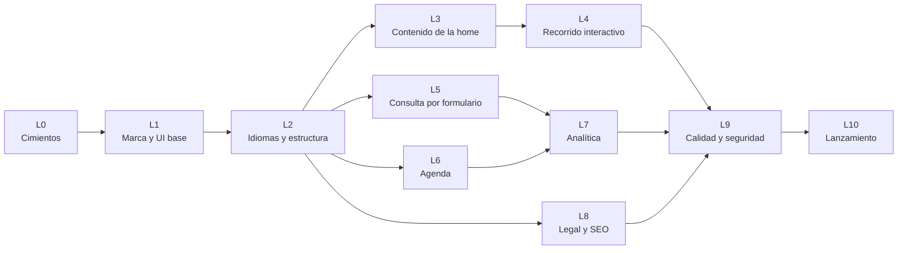

# Backlog inicial — Confia.ing Home v1

**Estado:** Aprobado. Actualizado el 2026-11-14 tras elegir diseño y logo y tras la revisión de las guías de trabajo

La implementación va por **lotes completos de funcionalidad**: cada lote es un cambio de OpenSpec (propuesta → especificación → tareas), se desarrolla con TDD y termina con pruebas en verde y revisión de código. Las referencias «PRD §» apuntan al [PRD](PRD-confia-ing-home-details.md); «CA» son los criterios de aceptación del PRD §12.

Prioridad: **M** imprescindible para lanzar · **S** debería estar · **C** si hay margen.

## L0 — Cimientos ✅

**Hecho el 2026-11-14**, incluido el enlace con el proyecto de producción. Evidencia en `openspec/changes/l0-cimientos/tasks.md`.

Sin funcionalidad visible; deja el proyecto listo para trabajar con SDD y TDD.

| ID | Tarea | Prio | Hecho cuando |
|---|---|---|---|
| L0-1 | `CLAUDE.md` (< 200 líneas) y `openspec/config.yaml` | M | Aprobados por el usuario antes de escribir código |
| L0-2 | Proyecto Next.js + TypeScript estricto + Tailwind v4 + OpenNext | M | `npm run dev` y `npm run preview` (runtime de Workers) sirven `/es` y `/en` con un layout raíz mínimo en `[locale]/` |
| L0-3 | Vitest, Testing Library, Playwright, axe, ESLint | M | `npm test` y `npm run e2e` pasan con una prueba de humo en cada nivel |
| L0-4 | Reglas de lint de arquitectura: tabla de dependencias de CLAUDE.md (`domain/` solo importa `zod`), sin colores literales bajo `src/` fuera de `tokens.css` | M | Una violación deliberada hace fallar el lint |
| L0-5 | Variables de entorno y selección de servicios | M | `SERVICES=memory|real`; con `real`, la falta de un secreto falla en el primer uso del servidor con un mensaje que nombra la variable; `.env.development.local` para desarrollo, `.env.prod` para producción |
| L0-6 | Supabase local y enlace con producción | M | `supabase start` levanta la base; proyecto enlazado |
| L0-7 | Medición del tamaño del Worker y del JS inicial | M | El build falla si el Worker supera 3 MiB comprimido; se mide el JS inicial de `/es` y se confirma el límite de 200 kB |
| L0-8 | ADR y estructura al día | M | ADR-0009 y ADR-0010 aceptados; carpetas `src/domain/scene/`, `src/lib/server/` y `tests/fixtures/` creadas |

## Cierre de la Fase 3 — Exploración de marca

Antes de programar, dentro de la dirección visual elegida. Aprobado por el usuario el 2026-11-14.

| ID | Entregable | Hecho cuando |
|---|---|---|
| F3-0 | Diseño visual elegido | Hecho: `docs/design/ronda5-cercano-3d-finalista.html` |
| F3-1 | 3 o 4 conceptos de logo | Presentados en `docs/design/logo-conceptos.html`. Cada uno con versión principal, compacta y símbolo, sobre fondo claro y oscuro, y prueba de legibilidad a 16 px |
| F3-2 | Dirección de imagen corporativa | Presentada en el mismo archivo. Tratamiento de ilustración, iconografía y diagramas del recorrido; sin robots ni cerebros |
| F3-3 | Aprobación del usuario | Hecho el 2026-11-14: «Cinco tramos» + punto naranja + «IA» resaltada en el nombre. Dirección de imagen presentada sin objeciones |

## L1 — Marca y sistema de interfaz ✅

**Hecho el 2026-11-14.** Evidencia en `openspec/changes/l1-marca-y-sistema-de-interfaz/tasks.md`. Guía en [docs/brand/](docs/brand/README.md).

Aplica la propuesta visual y el concepto de logo elegidos. PRD §6.7.

| ID | Historia | Prio | Criterios de aceptación |
|---|---|---|---|
| L1-1 | Tokens de diseño centralizados | M | Cambiar un color primario en `tokens.css` se refleja en toda la app; ningún componente contiene colores literales |
| L1-2 | Contraste garantizado | M | Prueba unitaria que verifica AA en cada pareja texto/fondo permitida |
| L1-3 | Tipografías auto-alojadas | M | Licencia abierta documentada; sin salto de diseño perceptible al cargar; acentos del español correctos |
| L1-4 | Logotipo y variantes | M | Concepto elegido en `docs/design/logo-conceptos.html`. SVG principal, compacto y símbolo; favicon reducido (arco continuo + punto); versiones para fondo claro y oscuro; favicon e icono; legible a 16 px |
| L1-5 | Componentes base: botón, enlace, campo, casilla, tarjeta, aviso | M | Estados reposo, hover, foco, activo, deshabilitado, error y éxito; operables con teclado |
| L1-8 | Componente de logo con el concepto elegido | M | El componente `Logo` de la implementación usa el símbolo de cinco tramos con punto y el nombre con «IA» resaltada. El archivo de diseño finalista no se modifica |
| L1-6 | Guía breve de marca en `docs/brand/` (parte de la ficha ya existente) | S | Paleta con HEX/RGB y roles, tipografías y licencias, usos del logo, ejemplos móvil y escritorio |

## L2 — Idiomas y estructura ✅

**Hecho el 2026-11-14.** Evidencia en `openspec/changes/l2-idiomas-y-estructura/tasks.md`.

PRD §6.1, §6.6, §9. CA: todo disponible en ES y EN con cambio manual.

| ID | Historia | Prio | Criterios de aceptación |
|---|---|---|---|
| L2-1 | Como visitante, llego en mi idioma | M | `/` redirige a `/es` o `/en` según cookie, luego navegador, luego español; entrar directo a `/en` nunca redirige |
| L2-2 | Como visitante, cambio de idioma y se recuerda | M | El selector lleva a la página equivalente; la elección persiste entre visitas; no hay cambios repetidos de idioma |
| L2-3 | Diccionarios tipados ES/EN | M | Una clave ausente en un idioma rompe la compilación |
| L2-4 | Header con anclas, selector y CTA de agenda | M | Navegación adaptable a móvil; menú operable con teclado; enlace «saltar al contenido» |
| L2-5 | Pie con contacto, legales e idioma | M | hola@confia.ing visible; enlaces a privacidad y términos en el idioma activo |
| L2-7 | Rutas legales provisionales | M | `/es/privacidad`, `/en/privacy`, `/es/terminos` y `/en/terms` existen con título y aviso de borrador; su contenido llega en L8 |
| L2-6 | Página 404 bilingüe | S | Una sola página con el mensaje en español e inglés y un enlace a la home de cada idioma; completa sin JavaScript |

## L3 — Contenido de la home ✅

**Hecho el 2026-11-14.** Evidencia en `openspec/changes/l3-contenido-de-la-home/tasks.md`. Pendiente del fundador: revisar la redacción inglesa en [docs/content/home.md](docs/content/home.md) (L3-7).

Para lotes siguientes: el botón coral sobre índigo claro y el borde de las tarjetas de fricción sobre salvia no alcanzan 3:1 como elementos gráficos (el texto sí cumple); revisar en L9-3.

PRD §5, §6.2, §6.3, §6.5, §7. CA: un visitante explica qué hace Confia.ing, para quién y cómo empezar.

| ID | Historia | Prio | Criterios de aceptación |
|---|---|---|---|
| L3-1 | Hero con mensaje y dos CTA | M | Los dos CTA son distinguibles; la llamada se describe como exploratoria; el contenido principal es visible sin esperar animaciones |
| L3-2 | Sección «Dónde empezamos» | M | Presenta fricciones reconocibles, no tecnologías; no menciona sectores objetivo |
| L3-3 | Pilares y servicios con jerarquía | M | Transformación de IA domina visualmente; los otros cuatro servicios aparecen subordinados y en el orden del PRD |
| L3-4 | Credibilidad del equipo | M | Solo la evidencia del PRD §7, atribuida al equipo y a trabajo previo; sin logos, nombres ni métricas |
| L3-5 | Mensaje de seguridad y cumplimiento | M | Lenguaje de enfoque y capacidad; ninguna afirmación de certificación |
| L3-6 | Cierre con frase y dos CTA | M | Repite ambas vías de contacto |
| L3-8 | Ritmo de secciones del diseño elegido | M | Alternan fondo crema y banda de color con esquinas suaves: salvia en «Dónde empezamos», coral claro en «Lo que ofrecemos», índigo claro en el cierre; tarjeta mantequilla para las preguntas |
| L3-7 | Redacción EN revisada | M | Traducción natural, no literal; mismos límites de claims |

## L4 — Recorrido interactivo

PRD §6.4, §9. CA: cinco etapas diferenciadas; utilizable con teclado y movimiento reducido.

| ID | Historia | Prio | Criterios de aceptación |
|---|---|---|---|
| L4-1 | Como visitante, recorro las cinco etapas | M | Cada etapa muestra qué se hace, qué recibe o decide el cliente y el paso siguiente |
| L4-2 | Navegación accesible | M | Patrón de pestañas con flechas, Inicio y Fin; foco visible; lectores de pantalla anuncian etapa y posición |
| L4-3 | Funciona sin JavaScript ni animación | M | Las cinco etapas están en el HTML inicial y son legibles con JS desactivado |
| L4-4 | Movimiento reducido | M | Con `prefers-reduced-motion`, los cambios son instantáneos |
| L4-5 | Adaptación a móvil | M | Usable con el pulgar a 375 px; sin desplazamiento horizontal de página |
| L4-6 | Avance guiado por desplazamiento | C | La etapa activa acompaña el scroll sin secuestrarlo |
| L4-8 | Escena 3D del camino (ADR-0009) | M | Un canvas que se muda entre hero, recorrido y cierre; al elegir una etapa el camino se construye hasta su terraza y la cámara la sigue; colores leídos de los tokens; render en pausa fuera de pantalla |
| L4-9 | Control de versión ligera / completa | M | En el pie; cambia de modo al instante, lo recuerda y explica por qué se activó el modo ligero cuando fue automático |
| L4-7 | Versión ligera (ADR-0009) | M | Sin WebGL, con conexión lenta, dispositivo limitado o movimiento reducido se sirve una versión estática coherente en colores, tipografía e imágenes; la librería 3D se descarga solo cuando aplica y después de que la página es legible |

## L5 — Consulta por formulario (Flujo B)

PRD §8, §9, §11. ADR-0002, 0003, 0006.

| ID | Historia | Prio | Criterios de aceptación |
|---|---|---|---|
| L5-1 | Como visitante, envío una consulta | M | Campos: nombre, empresa, correo, teléfono, mensaje; exige correo **o** teléfono |
| L5-2 | Consentimiento explícito | M | Casilla obligatoria no preseleccionada con enlace a privacidad y términos; se guarda fecha y versión del aviso |
| L5-3 | Errores accesibles | M | Cada error se asocia a su campo y se anuncia; el foco va al primer error; no se pierde lo escrito |
| L5-4 | Confirmación de recepción | M | Mensaje en pantalla sin plazo concreto; anunciado a lectores de pantalla |
| L5-5 | `POST /api/contact` | M | Valida en servidor con el mismo esquema; guarda en `contact_requests`; responde 201; rechaza con 4xx y mensaje localizado |
| L5-6 | Migración `contact_requests` con RLS | M | Sin políticas públicas; restricción correo-o-teléfono en la base |
| L5-7 | Antispam | M | Token de Turnstile verificado en servidor; campo trampa; límite de frecuencia; la IP no se persiste |
| L5-8 | Aviso a hola@confia.ing | M | Correo en texto plano con `Reply-To` del visitante; un fallo de envío no pierde la consulta |
| L5-10 | Dos modos: terminal y clásico (ADR-0010) | M | El visitante elige; ambos usan los mismos campos, esquema y errores; cambiar de modo conserva lo escrito; el tecleo animado se desactiva con movimiento reducido |
| L5-9 | Degradación | M | Si el envío falla, se muestra un error claro y la alternativa hola@confia.ing |

## L6 — Agenda (Flujo A)

PRD §9, §11.

| ID | Historia | Prio | Criterios de aceptación |
|---|---|---|---|
| L6-1 | Como visitante, reservo 30 minutos sin salir de la página | M | Calendly se carga al pulsar el CTA, en el idioma activo; nada de Calendly se descarga antes |
| L6-2 | Alternativa si el calendario no carga | M | Tras un tiempo de espera se ofrece el formulario y el enlace directo a Calendly |
| L6-3 | Confirmación y próximos pasos | M | Al completarse la reserva se muestra qué ocurrirá en la conversación |
| L6-4 | Accesibilidad del diálogo | M | Foco atrapado y devuelto al cerrar; se cierra con Escape; título anunciado |

## L7 — Analítica

PRD §3, §9. ADR-0005. CA: eventos medibles sin contenido sensible.

| ID | Historia | Prio | Criterios de aceptación |
|---|---|---|---|
| L7-1 | Visitas con Cloudflare Web Analytics | M | Script cargado solo si hay token; sin cookies |
| L7-2 | `POST /api/events` con lista cerrada | M | Solo acepta los ocho eventos definidos; descarta campos no previstos |
| L7-3 | Migración `analytics_events` con RLS | M | Sin IP, identificador de visitante ni texto libre |
| L7-4 | Instrumentación de CTA, calendario y formulario | M | Cada evento lleva idioma, dispositivo, ruta, host de referencia y UTM |
| L7-5 | Consultas SQL de conversión | S | Guardadas en `docs/`: conversión por idioma, dispositivo y canal |

## L8 — Legal y SEO

PRD §8, §10.

| ID | Historia | Prio | Criterios de aceptación |
|---|---|---|---|
| L8-1 | Borrador de Política de privacidad ES/EN | M | Base Ley 1581 de 2012: finalidad, datos, retención, derechos, canal de atención, proveedores; marcado «pendiente de revisión legal» |
| L8-2 | Borrador de Términos ES/EN | M | Marcado «pendiente de revisión legal» |
| L8-3 | Metadatos por idioma | M | Título, descripción, `lang`, `hreflang`, canónica y `x-default` |
| L8-4 | `sitemap.xml` y `robots.txt` | M | Incluyen todas las rutas de ambos idiomas |
| L8-6 | Imagen para compartir en redes (Open Graph) por idioma | S | Vista previa correcta al pegar el enlace |
| L8-5 | Datos estructurados de organización | S | JSON-LD válido |

## L9 — Calidad y seguridad

PRD §10. ADR-0001, 0008.

| ID | Tarea | Prio | Hecho cuando |
|---|---|---|---|
| L9-1 | E2E del Flujo A y del Flujo B en ES y EN | M | Pasan en Chromium de escritorio y WebKit móvil |
| L9-2 | E2E de teclado y movimiento reducido | M | Toda la home es operable sin ratón |
| L9-3 | Auditoría de accesibilidad automática | M | Sin infracciones de axe en home y legales |
| L9-4 | Presupuesto de rendimiento | M | LCP < 2,5 s y CLS < 0,1 en ambos modos de escena, con el perfil de medición de `openspec/config.yaml`; JS inicial de `/es` ≤ 200 kB comprimido |
| L9-5 | Cabeceras de seguridad y CSP | M | CSP sin `unsafe-inline` para scripts; HSTS; orígenes de terceros explícitos; `Referrer-Policy` compatible con el cambio de idioma (ADR-0012) |
| L9-6 | Auditoría con el skill `security-audit` | M | Hallazgos altos y medios corregidos o aceptados por escrito |
| L9-7 | Revisión de código de toda la v1 | M | Hallazgos resueltos |
| L9-8 | Latido diario contra la pausa de Supabase | M | Cron verificado en el entorno de preview |

## L10 — Lanzamiento

| ID | Tarea | Prio | Hecho cuando |
|---|---|---|---|
| L10-1 | Secretos de producción en el Worker | M | Cargados con `wrangler secret` |
| L10-2 | Migraciones aplicadas a `confiahomeDB` | M | `supabase db push` sin errores |
| L10-3 | Despliegue en `confia.ing` | M | Flujos A y B probados en producción; aviso de correo recibido |
| L10-4 | Subida de la v1 a GitHub | M | Código completo en `main` de `confiaing/confiahome` |
| L10-5 | README final | M | Refleja lo desplegado y cómo operarlo |

## Después de la v1

- Búsqueda de parecidos del logo con marcas registradas antes de registrarlo.
- CI con GitHub Actions, protección de rama y revisión por PR.
- Validación legal de privacidad y términos por un abogado (bloquea la promoción activa del sitio, no el despliegue técnico).
- Bios del equipo, casos de éxito y logos autorizados.
- Páginas por servicio.
- Acuse automático por correo al visitante.
- Panel de métricas.

## Pendiente de terceros

| Qué | Quién | Bloquea |
|---|---|---|
| Accesos de [docs/setup.md](docs/setup.md) | Usuario | L0-6, L5, L10 |
| Revisión legal | Abogado de Confia.ing | Promoción pública |
