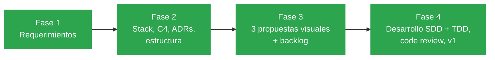
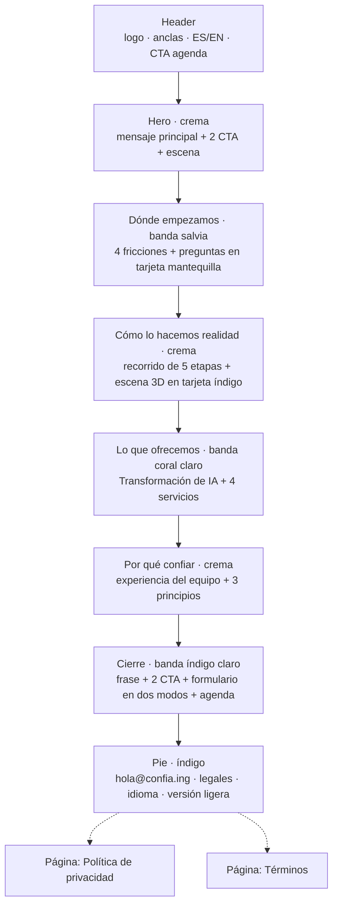
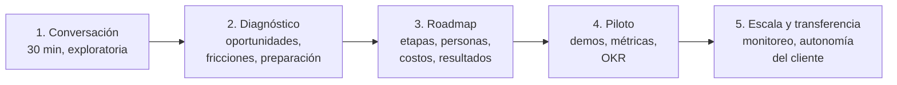
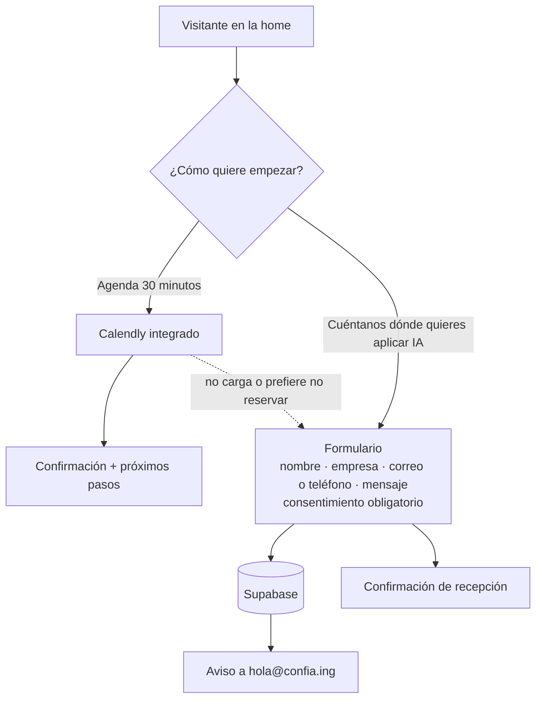
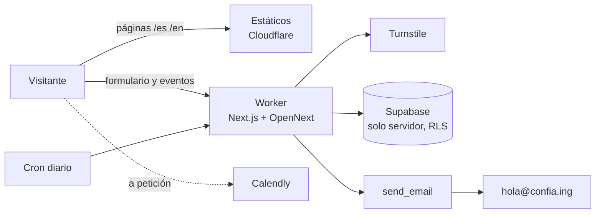

# Confia.ing — Home

Home pública de lanzamiento de **Confia.ing**, consultoría de transformación de IA para pymes. Bilingüe (ES/EN), con un recorrido interactivo del proceso de trabajo y dos vías de contacto: agendar 30 minutos o enviar una consulta.

> Documento vivo. Se actualiza al cierre de cada fase y con cada decisión relevante.
> **Última actualización:** 2026-11-17 · **Estado:** v1 en producción en <https://confia.ing> (lotes L0 a L10 hechos); v1.1 en curso, con L11 y L12 hechos y L13 siguiente. `main` está protegida: los cambios entran por pull request. Cómo operarlo: [docs/operations.md](docs/operations.md). Lo que sigue: «Después de la v1» en [BACKLOG.md](BACKLOG.md).

## Estado del proyecto



| Fase | Entregables | Estado |
|---|---|---|
| 1. Requerimientos | Análisis del PRD, entrevista, este README | Aprobada 2026-11-13 |
| 2. Arquitectura | Propuesta de stack, diagrama C4, componentes, ADRs, estructura de ficheros | Aprobada 2026-11-13 |
| 3. Diseño | Propuestas visuales, diseño finalista, logo, `BACKLOG.md` | Cerrada 2026-11-14 |
| 4. Implementación | `CLAUDE.md`, `config.yaml` de OpenSpec, código por lotes, pruebas, code review, subida de v1 | v1 en producción 2026-11-16 |

## Qué construimos

- **Para quién:** CEO y CTO de pequeñas y medianas empresas, de cualquier sector, que ya usan tecnología pero mantienen tareas manuales y repetitivas. Audiencia secundaria: líderes y equipos de software que necesitan capacitación en IA.
- **Para qué:** generar conversaciones calificadas. El indicador principal es reuniones agendadas y formularios completados; visitas y duración son diagnóstico.
- **Qué debe lograr la página:** que en una lectura rápida el visitante pueda explicar qué hace Confia.ing, para quién es y cómo empezar.
- **Idea central:** *Encuentra dónde la IA puede generar resultados en tu empresa.* Estrategia, capacitación y automatización integradas; no licencias ni experimentos aislados.

### Estructura de la página



Paleta, tipografías, temas por banda y logo: [ficha de marca](docs/brand/README.md).

### Recorrido que explica la Sección 2



Cada etapa indica qué se hace, qué recibe o decide el cliente y cuál es el paso siguiente. La llamada de 30 minutos nunca se presenta como diagnóstico ni como compromiso de implementación.

### Flujos de conversión



## Decisiones de la Fase 1

Resueltas en la entrevista del 2026-11-13. La numeración «PRD §15» remite a las decisiones pendientes del PRD.

| Tema | Decisión | Origen |
|---|---|---|
| Calendario (PRD §15.2) | Calendly, evento de 30 min: <https://calendly.com/confiaing/30min> | Usuario |
| Equipo y credibilidad (§15.6) | En colectivo, sin nombres ni bios. Solo la evidencia aprobada en PRD §7, atribuida al equipo y a trabajo previo. | Usuario |
| Costo del diagnóstico (§15.3) | No se menciona precio. Se describe qué es y qué entrega; alcance y condiciones se acuerdan tras la llamada. | Usuario |
| Textos legales (§15.1, §15.8) | Claude redacta borradores de privacidad y términos en ES/EN (base Ley 1581 de 2012, Colombia), marcados para revisión de un abogado antes de publicar. El pie usa solo la marca «Confia.ing». | Usuario |
| Tiempo de respuesta (§15.11) | Sin plazo concreto en la confirmación del formulario. | Usuario |
| Destino del formulario (§15.11) | Se guarda en Supabase y se notifica a hola@confia.ing. | Propuesta aceptada |
| Analítica (§15.9) | Sin cookies: Cloudflare Web Analytics para visitas, más eventos anónimos propios en Supabase. Sin banner de cookies. | Usuario |
| Consentimiento comercial | No se incluye la casilla opcional de marketing. Solo el consentimiento obligatorio para responder. | Usuario |
| Idioma | URLs separadas `/es` y `/en`. Detección por navegador; **español** por defecto si no es ES ni EN. La elección manual persiste. | Usuario |
| Infraestructura | Cloudflare + Supabase, planes gratuitos. Dominio `confia.ing`. | Usuario |

### Supuestos de Claude (corrígelos si no encajan)

- **Alcance de páginas:** home, privacidad y términos, cada una en ES y EN. Sin páginas por servicio en la v1.
- **Calendly se carga solo al pedirlo** (clic en el CTA), para no penalizar rendimiento ni cargar terceros sin acción del visitante. Si falla, se ofrece el formulario y el enlace directo.
- **«Reunión agendada» se mide** con el evento que emite el Calendly embebido; no requiere plan de pago.
- **Eventos analíticos:** vista de página, clic en cada CTA, apertura del calendario, reunión agendada, formulario iniciado, formulario enviado, cambio de idioma. Con idioma, tipo de dispositivo y canal (referrer/UTM). Nunca el contenido del mensaje ni datos personales. Quien activa «No rastrear» (Global Privacy Control o Do Not Track) no se mide. Cómo consultarlos: [docs/analytics.md](docs/analytics.md).
- **Antispam:** Cloudflare Turnstile más campo trampa en el formulario.
- **Textos (copy):** Claude propone toda la redacción ES/EN, incluida la frase de cierre (§15.10), para tu aprobación en la Fase 3.
- **Identidad visual (§15.13, §15.14):** se propone en la Fase 3 dentro de las tres alternativas de diseño; logo en SVG, paleta en tokens centralizados, tipografías de licencia abierta.
- **Seguridad y cumplimiento (§15.7):** la página habla de enfoque y capacidad de análisis; no afirma certificaciones.

### Aún abierto

- **Límites comerciales de cada etapa y soporte post-transferencia (§15.4, §15.5):** la página usará la descripción del PRD §6.4 tal cual («el soporte continuo puede contratarse aparte»). No bloquea.
- **Validación legal** de privacidad y términos antes de publicar en producción. Responsable: Confia.ing.
- **Acceso de escritura al repositorio** (ver abajo).

## Arquitectura (Fase 2)

**Next.js sobre Cloudflare Workers (OpenNext) + Supabase**, en planes gratuitos.



| Decisión | Resumen |
|---|---|
| [ADR-0001](docs/architecture/adr/0001-nextjs-sobre-cloudflare-workers.md) | Next.js + OpenNext, elegido por el usuario frente a Astro; con presupuesto de rendimiento y de tamaño del Worker |
| [ADR-0002](docs/architecture/adr/0002-acceso-a-supabase-solo-servidor.md) | Supabase solo desde el servidor, RLS sin políticas públicas, latido diario contra la pausa del plan gratuito |
| [ADR-0003](docs/architecture/adr/0003-notificaciones-por-correo.md) | Avisos con `send_email` de Cloudflare, sin proveedor ni API key |
| [ADR-0004](docs/architecture/adr/0004-internacionalizacion.md) | `/es` y `/en`, diccionarios tipados, detección sin middleware |
| [ADR-0005](docs/architecture/adr/0005-analitica-sin-cookies.md) | Cloudflare Web Analytics + eventos propios anónimos |
| [ADR-0006](docs/architecture/adr/0006-antispam.md) | Turnstile + campo trampa + límite de frecuencia |
| [ADR-0007](docs/architecture/adr/0007-tokens-de-diseno.md) | Tokens en `src/styles/tokens.css` con Tailwind v4 |
| [ADR-0008](docs/architecture/adr/0008-estrategia-de-pruebas.md) | Puertos y adaptadores; Vitest, Testing Library, Playwright |
| [ADR-0009](docs/architecture/adr/0009-escena-3d-y-version-ligera.md) | Escena 3D con Three.js en carga diferida y versión ligera en SVG obligatoria |
| [ADR-0010](docs/architecture/adr/0010-formulario-en-dos-modos.md) | Formulario en modo terminal y modo clásico sobre un mismo esquema |
| [ADR-0011](docs/architecture/adr/0011-fuentes-y-archivos-de-marca-en-el-repositorio.md) | Fuentes y archivos de marca guardados en el repositorio y generados por script |
| [ADR-0012](docs/architecture/adr/0012-cambio-de-idioma-en-el-servidor.md) | El cambio de idioma pasa por un punto del servidor que guarda la cookie |
| [ADR-0013](docs/architecture/adr/0013-pestanas-que-degradan-a-enlaces.md) | Las pestañas del recorrido son enlaces: las etapas se leen sin JavaScript |
| [ADR-0014](docs/architecture/adr/0014-supabase-por-postgrest-sin-sdk.md) | Supabase se usa por PostgREST con `fetch`, sin SDK: el Worker no crece |
| [ADR-0015](docs/architecture/adr/0015-agenda-en-su-bloque-con-el-widget-de-calendly.md) | La agenda se carga en su bloque, con el widget de Calendly y solo a petición |
| [ADR-0016](docs/architecture/adr/0016-entrada-propia-del-worker-cabeceras-y-tarea-diaria.md) | Entrada propia del Worker: cabeceras de seguridad con CSP por código de un solo uso, y tarea diaria |
| [ADR-0017](docs/architecture/adr/0017-integracion-continua-y-despliegue.md) | CI en GitHub Actions con la puerta de cierre y sin secretos; el despliegue sigue siendo manual |

Detalle: [C4, componentes, datos y seguridad](docs/architecture/README.md) · [estructura de ficheros](docs/architecture/estructura.md).

## Diseño (Fase 3)

Tres direcciones visuales con el mismo [contenido](docs/design/contenido-base.md). Son maquetas HTML navegables: ábrelas en el navegador y prueba el recorrido, el formulario y el ancho móvil. Cada una termina con su sistema de marca (paleta, tipografías, logo, estados).

| Propuesta | Carácter | Archivo |
|---|---|---|
| A · Editorial claro | Calmado y consultivo: papel cálido, serif editorial, verde profundo | [propuesta-a-editorial.html](docs/design/propuesta-a-editorial.html) |
| B · Técnico preciso | Rigor de ingeniería: fondo oscuro, retícula, monoespaciada, un acento vivo | [propuesta-b-tecnico.html](docs/design/propuesta-b-tecnico.html) |
| C · Cercano y vivo | Humano y optimista: bloques de color, índigo y coral, formas redondeadas | [propuesta-c-cercano.html](docs/design/propuesta-c-cercano.html) |

### Ronda 2 (2026-11-14)

La ronda 1 se consideró demasiado corporativa y poco memorable. Segunda ronda, una propuesta por skill de diseño:

| # | Skill | Concepto | Archivo |
|---|---|---|---|
| 1 | 3D Web Experience | «El camino se construye juntos»: losas sueltas que se ordenan en un sendero de cinco terrazas. Incluye versión ligera | [ronda2-1-3d.html](docs/design/ronda2-1-3d.html) |
| 2 | Emil Kowalski | «Movimiento y oficio»: tinta, papel y una señal bermellón; tareas dispersas que se ordenan en un flujo | [ronda2-2-emil.html](docs/design/ronda2-2-emil.html) |
| 3 | Taste | Dirección de arte con fotografía. **Incompleta**: se detuvo por consumo de tokens, sin pasar su verificación | [ronda2-3-taste.html](docs/design/ronda2-3-taste.html) |
| 4 | Hallmark | Tema Grid (cartel suizo): ultramar y rojo señal, solo tipografía | [ronda2-4-hallmark.html](docs/design/ronda2-4-hallmark.html) |
| 5 | Lo mejor de los cuatro | «El hilo»: puntos dispersos que un hilo naranja ordena etapa a etapa hasta formar una esfera. Incluye versión ligera | [ronda2-5-lo-mejor.html](docs/design/ronda2-5-lo-mejor.html) |

Requisito acordado: toda dirección con 3D o efectos pesados ofrece una versión ligera coherente en colores e imágenes. Tras elegir dirección se hace la exploración de logo e imagen corporativa (ver backlog) antes de programar.

### Ronda 3 — prueba de paleta (2026-11-14)

La ganadora en distribución, interacción, animación y 3D es la **propuesta 1 (Experiencia 3D)**. Se prueba con dos paletas de la ronda 1; solo cambian los tokens de color, no la estructura ni las tipografías.

| Prueba | Paleta | Archivo |
|---|---|---|
| 1.1 | «Cercano y vivo»: crema, índigo y coral | [ronda3-1.1-3d-paleta-cercano.html](docs/design/ronda3-1.1-3d-paleta-cercano.html) |
| 1.2 | «Editorial claro»: papel, verde profundo y ocre | [ronda3-1.2-3d-paleta-editorial.html](docs/design/ronda3-1.2-3d-paleta-editorial.html) |

### Ronda 4 — refinamiento de la 1.1 (2026-11-14)

[ronda4-cercano-3d-refinada.html](docs/design/ronda4-cercano-3d-refinada.html): la Experiencia 3D con la paleta **exacta** de «Cercano y vivo» (15 colores, sin derivados), banda salvia en «Lo que ofrecemos», cierre en índigo claro y dos propuestas de formulario tech conmutables: **A · Terminal** y **B · Consulta en vivo**.

### Ronda 5 — diseño finalista (2026-11-14)

[ronda5-cercano-3d-finalista.html](docs/design/ronda5-cercano-3d-finalista.html). Sobre la ronda 4:

- **Ritmo de secciones** como en «Cercano y vivo»: crema, banda de color con esquinas suaves, crema… (índigo en «Dónde empezamos», salvia en «Lo que ofrecemos», índigo claro en el cierre).
- **Los dos formularios se quedan**: el visitante elige entre modo terminal y modo clásico.
- **Calendario a la derecha** del formulario en escritorio.

### Diseño elegido y exploración de logo (2026-11-14)

**Diseño finalista:** [ronda5-cercano-3d-finalista.html](docs/design/ronda5-cercano-3d-finalista.html), con «Dónde empezamos» en salvia y «Lo que ofrecemos» en coral claro.

**Logo e imagen corporativa:** [logo-conceptos.html](docs/design/logo-conceptos.html) presenta siete conceptos: cuatro iniciales (Peldaños, El punto, Dos juntos, Cinco tramos) y tres que hacen visible la «IA» dentro de «confia» (Tecla IA, El punto de la i, IA en mayúscula), y la dirección de ilustración, iconografía y diagramas. **Elegido:** la «c» de cinco tramos (concepto 4) con el punto naranja en la abertura (del concepto 2) y el nombre con «IA» en mayúscula y en color (del concepto 7). Favicon reducido: arco continuo con punto.

Plan de trabajo: [BACKLOG.md](BACKLOG.md), once lotes de L0 a L10.

## Fuera de alcance (v1)

Portal de cliente o cuentas · apps nativas · landings por sector · logos o casos de éxito · newsletter y automatización de marketing · asesoría legal o certificaciones.

## Criterios de aceptación

Los del PRD §12. En resumen: dos CTA distinguibles en hero y cierre; llamada de 30 min descrita como exploratoria; cinco etapas diferenciadas con entregables claros; jerarquía de servicios visible; todo en ES y EN con cambio manual; formulario con correo o teléfono, consentimiento y enlaces legales; claims atribuidos al equipo; eventos medibles sin contenido sensible; utilizable en móvil, con teclado y con movimiento reducido; sin instalación.

## Cómo ejecutarlo en local

Requisitos: Node 26 (el de la CI). Docker solo si vas a usar la base de datos local. Montaje desde cero, Supabase local y cómo apagarlo al cerrar un lote: [docs/development.md](docs/development.md).

```bash
npm install
npm run dev            # http://localhost:3000/es · servicios en memoria, sin base de datos
```

| Comando | Qué hace |
|---|---|
| `npm run lint` · `npm run typecheck` | ESLint (incluidas las reglas de arquitectura) y TypeScript |
| `npm test` | Pruebas unitarias y de integración, sin red |
| `npm run e2e` | Playwright contra el build de producción |
| `npm run build:worker` | Construye el Worker; falla si lleva secretos o supera 3 MiB |
| `npm run measure:js` | JS inicial de `/es` frente al límite |
| `npm run brand:build` | Regenera los archivos del logo y los iconos de `public/brand/` |
| `npm run content:doc` | Regenera `docs/content/home.md`, el texto ES y EN lado a lado |
| `npm run preview` | La app en el runtime real de Cloudflare Workers |
| `npx supabase start` · `npx supabase stop` | Arranca o detiene la base de datos local en Docker |

Estado medido el 2026-11-14: Worker de 847 KiB (72 % de margen) y 135 kB de JS inicial.

## Recursos y accesos

Verificados el 2026-11-13.

| Recurso | Referencia | Estado |
|---|---|---|
| Dominio | `confia.ing` (Cloudflare) | DNS y correo activos; sin sitio publicado |
| Correo | hola@confia.ing, con reenvío por Email Routing a un buzón verificado | Configurado por el usuario |
| Repositorio | <https://github.com/confiaing/confiahome> | Público y vacío. Sesión de `gh` como `confiaing` con permiso de escritura (verificado) |
| Supabase | Proyecto `confiahomeDB` · `https://nojdfpoqmrjpxkaqskyv.supabase.co` | Responde con la publishable key. Falta acceso de administración para crear tablas |
| Calendario | <https://calendly.com/confiaing/30min> | Activo |
| Cloudflare (cuenta) | Despliegue, Web Analytics, Turnstile | Sin probar; requiere `wrangler login` |
| Entorno local | MacBook Pro M5, 32 GB · Node 26 · npm 12 · git · OpenSpec · Docker | Docker instalado pero detenido; `wrangler` y CLI de Supabase se instalan en la Fase 4 |

### Lo que necesitaré de ti

Los pasos están en [docs/setup.md](docs/setup.md): abrir Docker, `supabase login`, secret key de Supabase, `wrangler login`, Turnstile, Web Analytics y dirección de aviso. Hacen falta al empezar la Fase 4.

Desarrollo usa Supabase local en Docker; producción usa `confiahomeDB`.

Las claves van en `.env.development.local` (desarrollo) y `.env.prod` (producción), ambos ignorados por git, con `.env.example` como plantilla documentada. `.env` no contiene secretos. La publishable key de Supabase es pública por diseño; las secretas nunca se suben.

## Cómo se construyó: desarrollo agéntico

La v1 la construyó un agente de programación (Claude Code) trabajando con el fundador: el fundador decidió producto, diseño y cada paso a producción; el agente propuso, implementó, probó y documentó. Esta sección resume las herramientas y las prácticas de ciclo de vida (AI-SDLC) que lo hicieron posible, para repetirlas en otros proyectos.

### Stack agéntico

| Pieza | Para qué se usó |
|---|---|
| **Claude Code** (app de escritorio) | Agente principal: lee y edita el repositorio, ejecuta comandos y pruebas, abre el navegador integrado para revisar la página |
| **Modelos Claude** | Claude Fable 5.2 en casi todo el desarrollo; Claude Opus 5.5 desde el cierre de la v1, al agotarse el cupo semanal de Fable |
| **Subagentes** | Revisores independientes de código y de seguridad al cierre de cada lote: reciben el código, no las conclusiones del agente principal |
| **[OpenSpec](openspec/config.yaml)** | Desarrollo guiado por especificaciones: comandos `/opsx:propose`, `/opsx:apply`, `/opsx:verify`, `/opsx:archive` (en [.claude/](.claude/)) |
| **[CLAUDE.md](CLAUDE.md)** | Guion de incorporación del agente: rol, método, estructura, dependencias permitidas, reglas rojas y trampas conocidas |
| **CLI con sesión del fundador** | `gh` (GitHub y CI), `wrangler` (Cloudflare), `supabase` (migraciones); las credenciales nunca pasan por el chat |
| **Navegador integrado y Playwright** | Comprobación visual en Chromium y WebKit, pruebas E2E y verificación de producción |

### Skills

Un skill es un paquete de instrucciones que el agente carga para un tipo de tarea. Los que guiaron este proyecto:

| Área | Skills | Aporte |
|---|---|---|
| Proceso | `superpowers:test-driven-development`, `superpowers:verification-before-completion`, `superpowers:systematic-debugging` | Prueba antes que código; nada se da por hecho sin ver la salida; los fallos se diagnostican antes de arreglarse |
| Especificación | `openspec-propose`, `openspec-apply-change`, `openspec-verify-change` | Propuesta, specs, diseño y tareas antes de cada lote |
| Código | `mattpocock-skills:tdd`, `mattpocock-skills:codebase-design`, `architecture` | Arquitectura hexagonal, módulos con fronteras claras, ADRs con alternativas reales |
| Interfaz | `emil-design-eng`, `animate`, `mobile-native`, `3d-web-experience` | Detalle de interacción, movimiento con propósito, ajustes para móvil y la escena 3D |
| Revisión | `fullstack-dev-skills:code-reviewer` (plugin de Jeffallan) en la v1; [`aitmpl-code-reviewer`](.claude/skills/aitmpl-code-reviewer/SOURCE.md) desde la v1.1; `security-audit` (de Cloudflare) | Revisión de cada lote y auditoría de seguridad antes del lanzamiento ([informe](docs/security/audit-v1.md)). El fundador pidió el skill [`code-reviewer` de aitmpl.com](https://www.aitmpl.com/component/skills/development/code-reviewer) desde L0, pero no se instaló hasta L11: en la v1 se usó otro con el mismo nombre. Ahora está en el repositorio con nombre propio, porque `code-reviewer` a secas carga el del plugin |

### Buenas prácticas de AI-SDLC

1. **Fases con aprobación humana.** Requerimientos → arquitectura → diseño → implementación. Ninguna fase empezó sin que el fundador aprobara la anterior.
2. **Lotes pequeños (L0 a L10).** Cada lote es un cambio de OpenSpec en [openspec/changes/](openspec/changes/), se cierra entero antes de abrir el siguiente y termina en un commit local.
3. **Especificación antes que código (SDD).** Escenarios GIVEN/WHEN/THEN en [docs/escenarios.md](docs/escenarios.md); el fundador aprueba la propuesta antes de implementar.
4. **Prueba antes que implementación (TDD).** Cada escenario automático se escribe y se ve fallar primero. Pirámide: unitario, integración (nivel principal), contrato contra Supabase local y E2E, también contra el runtime real de Workers.
5. **Una puerta de cierre única.** `lint`, `typecheck`, `test`, `e2e`, `e2e:preview`, `build:worker` y `measure:js` en verde y con la salida a la vista. La CI de GitHub repite la misma puerta ([ADR-0017](docs/architecture/adr/0017-integracion-continua-y-despliegue.md)).
6. **Verificar antes de afirmar.** «Hecho» significa comando ejecutado y salida vista; lo no comprobado se declara. La evidencia de cada lote queda en su `tasks.md`.
7. **Revisión independiente.** Un subagente revisa sin el razonamiento del autor, lo que evita confirmar sesgos. Sus hallazgos se corrigen o se aceptan por escrito.
8. **Reglas rojas para el agente.** Lo que invalida el trabajo aunque las pruebas pasen: secretos fuera del código y del chat, nada de Supabase desde el navegador, nada de datos inventados, ni `push` ni despliegue sin orden expresa del fundador.
9. **Decisiones trazables.** Cada decisión con alternativas reales es un [ADR](docs/architecture/adr/); README y BACKLOG se actualizan al cerrar cada lote.
10. **Producción medida, no supuesta.** Tras cada despliegue, un verificador de solo lectura (`npm run verify:site`) y pruebas en navegadores reales. Así se detectaron y corrigieron dos fallos que no aparecían en local.
11. **Gestión del contexto y del cupo.** Pausas seguras con una nota «Para reanudar» en el `tasks.md` del lote, para compactar el contexto o cambiar de modelo sin perder el estado.

### Revisión de código antes de subir cambios

Decidido el 2026-11-16 (decisión D1 de la v1.1): no hay revisión automática de código en GitHub. Quien cambie el repositorio con Claude Code ejecuta **`/code-review` en local antes de cada `push`**, sin coste ni secretos en GitHub. Al cerrar cada lote, además, el skill `aitmpl-code-reviewer` (versionado en `.claude/skills/`) revisa el lote completo en un subagente independiente.

1. Terminar el cambio con la puerta de cierre en verde.
2. Ejecutar `/code-review` en Claude Code sobre el cambio.
3. Corregir los hallazgos, o anotar en el `tasks.md` del lote por qué se aceptan.
4. Repetir la puerta de cierre si hubo correcciones.
5. Solo entonces hacer `push` de la rama y abrir el pull request, con la orden del fundador. La CI de GitHub repite la puerta de cierre, pero no sustituye a la revisión.

**Flujo por rama** (desde L12): cada lote se trabaja en una rama `lote/<nombre>` creada desde `main` y entra por pull request. `main` está protegida: exige `quality`, `contract`, `e2e` y `e2e-preview` en verde y la rama al día, no admite push directo (tampoco del fundador) y no se puede forzar ni borrar. Con la CI en verde, el fundador funde el pull request. Detalle y urgencias en [docs/operations.md](docs/operations.md#protección-de-main).

**Profundidad según el riesgo** (decidido el 2026-11-16):

| Tipo de cambio | Ejemplos | Revisión |
|---|---|---|
| Documentación, especificaciones o configuración sin efecto en el sitio | README, BACKLOG, ADR, OpenSpec | `/code-review low` |
| Código acotado, de riesgo bajo | Un componente, textos, estilos, scripts de marca | `/code-review medium` |
| Código con riesgo | `worker/`, cabeceras y CSP, `src/app/api/`, formulario, Supabase y migraciones, Turnstile, CI y despliegue | `/code-review high`; si el cambio es grande, se recomienda `/ultrareview` |
| Antes de cada despliegue a producción | Lo que se va a desplegar | Se recomienda `/ultrareview` |

`/ultrareview` (equivale a `/code-review ultra`) revisa en la nube con varios agentes y se cobra aparte: solo lo lanza el fundador. El agente lo recomienda cuando toca, y en el informe de cada lote dice qué nivel usó. Los niveles `max` y `ultra` nunca se usan sin que el fundador lo pida.


## Documentos

| Documento | Contenido |
|---|---|
| [PRD-confia-ing-home-details.md](PRD-confia-ing-home-details.md) | Requisitos de producto (fuente) |
| [docs/architecture/](docs/architecture/README.md) | C4, componentes, datos, seguridad, [estructura](docs/architecture/estructura.md) y [ADRs](docs/architecture/adr/) |
| [.env.example](.env.example) | Variables de entorno documentadas |
| [BACKLOG.md](BACKLOG.md) | Backlog por lotes |
| [docs/escenarios.md](docs/escenarios.md) | Escenarios GIVEN/WHEN/THEN de cada ítem del backlog: la guía de las pruebas |
| [docs/setup.md](docs/setup.md) | Guía de accesos: Supabase, Cloudflare, correo |
| [docs/development.md](docs/development.md) | Entorno local: montarlo, Supabase en Docker y apagarlo al cerrar un lote o una versión |
| [docs/operations.md](docs/operations.md) | Operación: desplegar, volver atrás, secretos, consultas, tarea diaria, vigilancia, dependencias y protección de `main` |
| [docs/content/home.md](docs/content/home.md) | Texto de la home en español e inglés, para revisión editorial |
| [docs/brand/README.md](docs/brand/README.md) | Ficha de marca: paleta, temas, tipografía, logo e imagen |
| [docs/design/](docs/design/contenido-base.md) | Contenido base, propuestas visuales, diseño finalista y logo |
| [CLAUDE.md](CLAUDE.md) | Guía de trabajo para agentes: rol, método, estructura y reglas rojas |
| [openspec/config.yaml](openspec/config.yaml) | Estándares del proyecto para el desarrollo guiado por especificaciones |

## Referencias

- Estructura y enfoque (no marca): [Supermodular.ai](https://www.supermodular.ai/), [Dagg.ai](https://dagg.ai/), [SF AI Labs](https://www.sfailabs.com/)
- Metodología: OpenSpec (SDD), TDD, pirámide de pruebas (unitario, integración como nivel principal, E2E de los flujos A y B)
