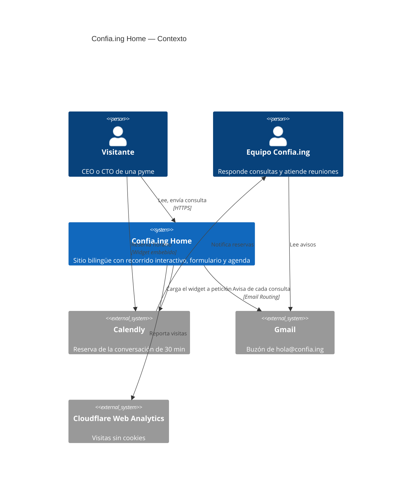
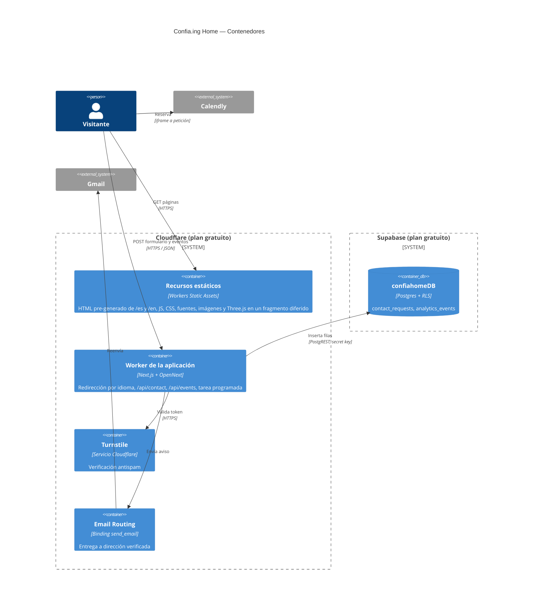
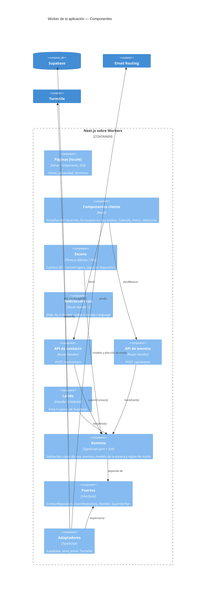
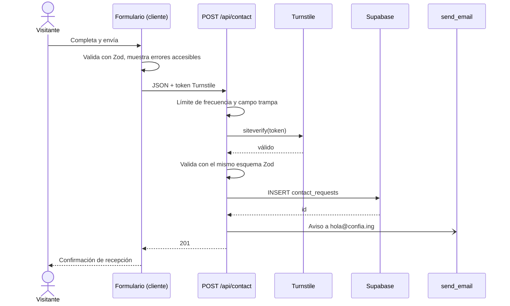
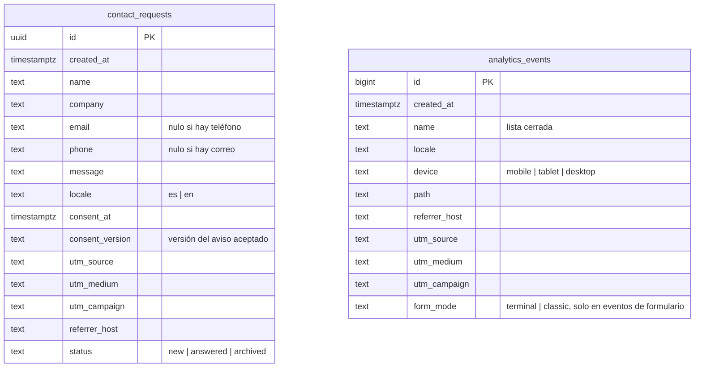

# Arquitectura — Confia.ing Home

**Estado:** Aceptada. Actualizada el 2026-11-14 con el diseño elegido (ADR-0009 y ADR-0010) y con las fuentes y archivos de marca ([ADR-0011](adr/0011-fuentes-y-archivos-de-marca-en-el-repositorio.md)) y el cambio de idioma ([ADR-0012](adr/0012-cambio-de-idioma-en-el-servidor.md))

Stack elegido: **Next.js (App Router) sobre Cloudflare Workers con OpenNext**, **Supabase** como base de datos, todo en planes gratuitos. Las decisiones y sus alternativas están en [adr/](adr/).

## Stack

| Capa | Tecnología | Por qué |
|---|---|---|
| Framework | Next.js (App Router), React, TypeScript estricto | Elegido por el usuario ([ADR-0001](adr/0001-nextjs-sobre-cloudflare-workers.md)) |
| Despliegue | Cloudflare Workers + `@opennextjs/cloudflare`, `wrangler` | Restricción: Cloudflare gratis |
| Estilos | Tailwind CSS v4 con tokens en variables CSS | Paleta centralizada, PRD §6.7 ([ADR-0007](adr/0007-tokens-de-diseno.md)) |
| Escena 3D | Three.js, carga diferida, con versión ligera en SVG | Diseño elegido ([ADR-0009](adr/0009-escena-3d-y-version-ligera.md)) |
| Animación | CSS y Web Animations API, con `prefers-reduced-motion` | Sin librería de animación |
| Tipografías | Fraunces, Figtree y DM Mono, auto-alojadas | Diseño elegido |
| Base de datos | Supabase Postgres, acceso solo desde el servidor | [ADR-0002](adr/0002-acceso-a-supabase-solo-servidor.md) |
| Correo | Binding `send_email` de Cloudflare a dirección verificada | Sin proveedor ni API key ([ADR-0003](adr/0003-notificaciones-por-correo.md)) |
| Antispam | Cloudflare Turnstile + campo trampa + límite de frecuencia | [ADR-0006](adr/0006-antispam.md) |
| Analítica | Cloudflare Web Analytics + eventos propios anónimos | Sin cookies ([ADR-0005](adr/0005-analitica-sin-cookies.md)) |
| Validación | Zod, esquema compartido cliente/servidor | Una sola fuente de reglas |
| Pruebas | Vitest, Testing Library, Playwright, axe | [ADR-0008](adr/0008-estrategia-de-pruebas.md) |
| Proceso | OpenSpec (SDD), TDD, npm | Requisito del usuario |

Las versiones exactas se fijan al instalar en la Fase 4 (última estable de cada paquete) y quedan en `package.json`.

Marca, paleta y ritmo de secciones: [ficha de marca](../brand/README.md).

## C4 — Nivel 1: Contexto

## C4 — Nivel 2: Contenedores

## C4 — Nivel 3: Componentes del Worker

## Componentes

| Componente | Ubicación | Responsabilidad | Pruebas |
|---|---|---|---|
| Páginas `[locale]` | `src/app/[locale]/` | Renderizar home y legales en el servidor, pre-generadas para `es` y `en`; metadatos SEO y `hreflang` | E2E |
| Redirección raíz | `src/app/route.ts` | `/` → `/es` o `/en`: cookie de preferencia, luego `Accept-Language`, luego español | Integración |
| Secciones | `src/components/sections/` | `home-content` compone hero, dónde empezamos, etapas, servicios, confianza y cierre; cada sección recibe su parte del diccionario | Integración (Testing Library) + E2E |
| Recorrido | `src/components/journey/` | Cinco etapas navegables con teclado; todo el contenido presente en el HTML sin JS ni animación | Integración + axe |
| Escena | `src/components/journey/scene/` | Un canvas WebGL que se muda entre hero, recorrido y cierre; SVG isométrico equivalente en modo ligero; control de modo en el pie | Integración (ligero) + E2E |
| Modelo de escena | `src/domain/scene/` | Geometría del camino, estado por etapa y reglas para elegir modo completo o ligero | Unitario |
| Formulario | `src/components/contact/` | Modo terminal y modo clásico sobre los mismos campos y esquema ([ADR-0010](adr/0010-formulario-en-dos-modos.md)); validación accesible, Turnstile, estados de envío/éxito/error | Integración parametrizada por modo + E2E |
| Agenda | `src/components/scheduling/` | Carga Calendly al hacer clic; escucha `calendly.event_scheduled`; si falla, ofrece formulario y enlace directo | Integración + E2E |
| UI base | `src/components/ui/` | Botón, enlace, tarjeta, campo, aviso: solo usan tokens | Integración |
| Dominio de contacto | `src/domain/contact/` | Esquema Zod (correo **o** teléfono, consentimiento), caso de uso `submitContact` | Unitario |
| Dominio de analítica | `src/domain/analytics/` | Lista cerrada de eventos, normalización de dispositivo/canal, `trackEvent` | Unitario |
| i18n | `src/i18n/` | Diccionarios tipados `es`/`en`, negociación de idioma, tabla de rutas localizadas y alternos `hreflang` | Unitario |
| Cambio de idioma | `src/app/api/locale/route.ts` | Guarda la cookie `locale` y redirige a la página equivalente ([ADR-0012](adr/0012-cambio-de-idioma-en-el-servidor.md)) | Integración + E2E |
| Marco | `src/components/sections/` (`skip-link`, `site-header`, `site-footer`) | Enlace de salto, cabecera con menú plegable y pie, compuestos en el layout | Integración + E2E |
| Adaptadores | `src/adapters/` | Supabase, correo, Turnstile; únicos puntos que tocan servicios externos | Integración (contrato) |
| API de contacto | `src/app/api/contact/route.ts` | Límite de frecuencia → Turnstile → validar → guardar → avisar | Integración |
| API de eventos | `src/app/api/events/route.ts` | Validar contra la lista cerrada → guardar | Integración |
| Latido | `worker/scheduled.ts` | Consulta diaria mínima a Supabase | Integración |
| Tokens | `src/styles/tokens.css` | Única fuente de color, tipografía, espaciado y radios | Lint (sin colores literales bajo `src/`) |

## Flujo del formulario

Si el correo falla, la consulta ya está guardada y la respuesta sigue siendo 201; el fallo se registra en los logs del Worker.

## Modelo de datos

Las tablas no se relacionan: los eventos son anónimos a propósito. No se guarda IP, user-agent completo ni identificador de visitante. Restricción en base de datos: `email` o `phone` no nulo. Retención propuesta para el borrador legal: 24 meses para consultas, 13 meses para eventos.

**Eventos (lista cerrada):** `page_view`, `cta_schedule_click`, `cta_contact_click`, `calendar_opened`, `meeting_scheduled`, `form_started`, `form_submitted`, `language_switched`. Los dos eventos de formulario llevan además `form_mode` (`terminal` o `classic`).

## Seguridad

| Riesgo | Control |
|---|---|
| Clave secreta de Supabase expuesta | Solo existe como secreto del Worker (`wrangler secret`) y en `.env` local ignorado por git. El navegador nunca habla con Supabase. |
| Lectura o escritura pública de datos personales | RLS activado en ambas tablas, **sin** políticas para `anon`/`authenticated`. Solo la secret key del servidor puede operar. |
| Spam y abuso del formulario | Turnstile verificado en servidor, campo trampa, límite de frecuencia por IP (no se persiste la IP), tamaño máximo de cuerpo |
| Inyección y XSS | Zod en servidor, consultas parametrizadas del cliente Supabase, React escapa por defecto, el correo de aviso va en texto plano |
| Cabeceras | CSP con orígenes explícitos (Calendly, Turnstile, Cloudflare Insights), HSTS, `X-Content-Type-Options`, `Referrer-Policy`, `frame-ancestors 'none'` |
| CSRF en las API | Comprobación de `Origin` y solo `Content-Type: application/json` |
| Terceros | Calendly se carga solo tras la acción del visitante |
| Proyecto Supabase pausado | Tarea programada diaria ([ADR-0002](adr/0002-acceso-a-supabase-solo-servidor.md)) |

Antes de publicar la v1 se ejecuta la auditoría con el skill `security-audit` de Cloudflare.

## Límites del plan gratuito a vigilar

| Servicio | Límite relevante | Margen |
|---|---|---|
| Workers | 100 000 peticiones/día; los estáticos no cuentan | Amplio: solo `/`, las API y el cron invocan el Worker |
| Workers | Tamaño del script comprimido (3 MB en gratis) | **Riesgo principal de Next.js**; se mide en cada build. Three.js va al navegador, no al Worker |
| Supabase | Pausa tras 7 días sin actividad; 500 MB | Cubierto por el latido |
| Email | Solo a direcciones verificadas | Suficiente: el único destinatario es el equipo |
| Turnstile | Gratis | Sin límite práctico |

## Entornos

| | Local | Producción |
|---|---|---|
| App | `next dev` con servicios en memoria; `npm run preview` para el runtime real | Worker en `confia.ing` |
| Base de datos | Supabase local en Docker (`supabase start`) | Proyecto `confiahomeDB` |
| Turnstile | Claves de prueba oficiales | Claves reales |
| Correo | Adaptador en memoria | `send_email` |
| Secretos | `.env.development.local` (`.env` no contiene secretos) | `wrangler secret put`; `.env.prod` solo para cargarlos y migrar |
| Servicios | `SERVICES=memory` por defecto; `real` apunta a Supabase local | `SERVICES=real` |

Las migraciones se prueban en local y se aplican a producción con `supabase db push`. Las pruebas automáticas no tocan ninguna base de datos: usan adaptadores en memoria; las de contrato corren contra la local.
