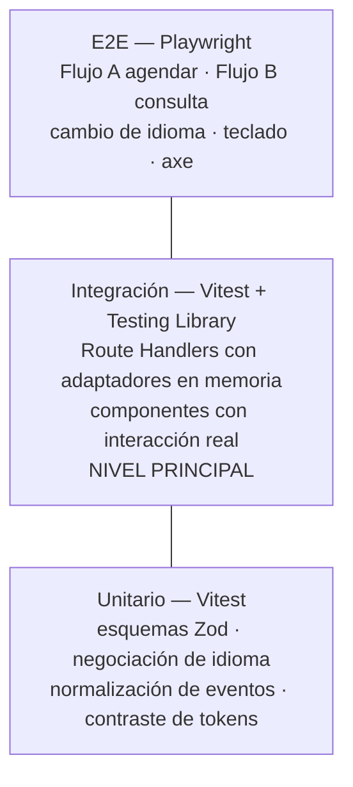

# ADR-0008: Estrategia de pruebas y arquitectura de puertos y adaptadores

**Estado:** Aceptada · **Fecha:** 2026-11-13

## Contexto

El usuario exige TDD y una pirámide con unitario (lógica pura), integración (nivel principal) y E2E (flujos principales). La aplicación depende de tres servicios externos: Supabase, Turnstile y correo.

## Decisión

La lógica vive en `src/domain/` como TypeScript puro y depende de interfaces (`ContactRepository`, `EventRepository`, `Notifier`, `SpamVerifier`). Los adaptadores reales están en `src/adapters/`; las pruebas usan adaptadores en memoria.

| Nivel | Herramienta | Qué cubre | Servicios externos |
|---|---|---|---|
| Unitario | Vitest | Funciones puras del dominio e i18n | Ninguno |
| Integración | Vitest, Testing Library, `vitest-axe` | Handlers de extremo a extremo con adaptadores en memoria; componentes renderizados con interacción de usuario; redirección de idioma | Ninguno (red simulada con MSW para Turnstile) |
| Contrato | Vitest, `npm run test:contract` | Adaptador de Supabase y migraciones contra **Supabase local**; Turnstile con sus claves de prueba | Supabase local, Turnstile (pruebas) |
| E2E | Playwright (Chromium y WebKit móvil) contra el build de producción | Flujos A y B, ES/EN, teclado, movimiento reducido, accesibilidad, presupuesto de rendimiento | Ninguno: `SERVICES=memory`, con Turnstile y Calendly simulados |

## Opciones consideradas

- **Supabase local con Docker para integración:** más realista, pero lento y frágil para TDD; se sustituye por las pruebas de contrato.
- **Pirámide dominada por E2E:** lenta y poco precisa al fallar.

## Consecuencias

- Ciclo TDD rápido: unitario e integración corren sin red.
- El dominio no importa Next.js, Supabase ni Cloudflare; una regla de lint lo impone.
- Calendly real no se prueba de forma automática: el E2E simula su mensaje `event_scheduled` y verifica la alternativa cuando no carga.
- En la v1 las pruebas se ejecutan en local; la integración continua con GitHub Actions llega después de la primera subida.
