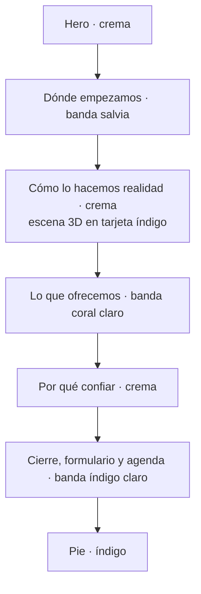

# Marca Confia.ing — ficha de referencia

Resumen de lo decidido en la Fase 3. Es la referencia rápida mientras se construye; la guía de marca completa, con los archivos finales del logo, se produce en el lote L1 (L1-4, L1-6).

**Fuentes:** [diseño finalista](../design/ronda5-cercano-3d-finalista.html) · [logo](../design/logo-conceptos.html) · [ADR-0007](../architecture/adr/0007-tokens-de-diseno.md)

## Paleta

Quince colores, sin derivados. En el código viven solo en `src/styles/tokens.css`.

| Primitivo | HEX | Papel |
|---|---|---|
| `indigo-900` | `#1B1F4B` | Texto, fondo oscuro, texto sobre coral |
| `indigo-700` | `#2D3380` | Enlaces, foco, superficie en oscuro |
| `indigo-500` | `#4A4E78` | Texto atenuado |
| `indigo-300` | `#7A7E9E` | Borde fuerte |
| `indigo-100` | `#D9DBF0` | Banda de cierre, texto atenuado en oscuro |
| `coral-500` | `#FF6B4A` | Acción principal (con texto índigo) |
| `coral-300` | `#FF8566` | Hover, banda de «Lo que ofrecemos» |
| `coral-700` | `#B8371A` | Texto de acento y énfasis |
| `butter-300` | `#FFD979` | Superficie cálida, foco y enlace en oscuro |
| `sage-300` | `#BFD8C2` | Superficie fresca, banda de «Dónde empezamos» |
| `cream-50` | `#FBF5EA` | Fondo de página |
| `sand-200` | `#F1E6D2` | Fondo alterno, borde |
| `white` | `#FFFFFF` | Superficie de tarjetas |
| `red-700` | `#B3261E` | Error |
| `green-700` | `#1E6B45` | Éxito |

**Reglas de uso**

- El coral nunca lleva texto blanco: no cumple contraste. Lleva índigo 900.
- Como texto, el acento es coral 700, no coral 500.
- Sobre índigo, el foco y los enlaces van en mantequilla.

## Temas por banda

Cada banda reasigna los roles semánticos; los componentes no cambian.

| Tema | Fondo | Dónde |
|---|---|---|
| base | crema | Hero, recorrido, «Por qué confiar» |
| `theme-fresh` | salvia | «Dónde empezamos» |
| `theme-warm` | mantequilla | Tarjeta de preguntas |
| `theme-dark` | índigo 900 | Tarjeta de la escena, «Transformación de IA», terminal, pie |
| `theme-coral` | coral 300 | «Lo que ofrecemos» |
| `theme-calm` | índigo 100 | Cierre |

## Ritmo de la página

Las bandas de color no llegan al borde de la ventana y tienen esquinas suaves (entre 28 y 48 px).

## Tipografía

| Familia | Uso | Pesos |
|---|---|---|
| Fraunces | Títulos y cifras; cursiva para el énfasis | 400 a 700 |
| Figtree | Texto e interfaz | 400 a 700 |
| DM Mono | Etiquetas, números de etapa, terminal | 400 y 500 |

Las tres son de licencia abierta (SIL OFL) y se sirven desde el propio dominio.

## Logo

Concepto elegido el 2026-11-14: **cinco tramos, el punto y la IA**.

- **Símbolo:** una «c» construida con cinco tramos, uno por etapa del recorrido; el último en coral. En la abertura, un punto coral: lo que sigue en marcha, el «.ing».
- **Nombre:** «conf» en Fraunces ligera, «IA» en mayúscula en Figtree y en coral, «.ing» en cursiva.
- **Favicon reducido:** arco continuo con el punto, para 16 px, donde los cinco tramos se funden.
- **Variante disponible:** tramos de un solo color con el punto en coral.

Pendiente en L1: trazados SVG definitivos, versiones para fondo claro y oscuro, favicon, y la búsqueda de parecidos con marcas registradas antes de registrarlo.

## Imagen

- **Ilustración:** bloques isométricos que pasan de dispersos a formar un camino, con dos esferas (tú y nosotros). Color plano, contorno índigo fino.
- **Iconos:** trazo redondeado de 1,75 px en índigo, con un solo elemento en coral.
- **Diagramas:** una línea con paradas numeradas; lo recorrido en coral.
- **No se usa:** robots, cerebros, redes neuronales, degradados «de IA», fotografía de archivo.

## Formulario

Dos modos a elección del visitante: terminal (índigo, con tecleo animado) y clásico (con un panel `consulta.json` que se escribe en vivo). Ver [ADR-0010](../architecture/adr/0010-formulario-en-dos-modos.md).
