# Marca Confia.ing — ficha de referencia

Guía de marca. Recoge lo decidido en la Fase 3 y lo construido en el lote L1: tokens, tipografías, logo y sus archivos.

**Fuentes:** [tokens](../../src/styles/tokens.css) · [diseño finalista](../design/ronda5-cercano-3d-finalista.html) · [logo](../design/logo-conceptos.html) · [ADR-0007](../architecture/adr/0007-tokens-de-diseno.md)

## Paleta

Quince colores, sin derivados. En el código viven solo en `src/styles/tokens.css`.

| Primitivo | HEX | RGB | Papel |
|---|---|---|---|
| `indigo-900` | `#1B1F4B` | 27, 31, 75 | Texto, fondo oscuro, texto sobre coral |
| `indigo-700` | `#2D3380` | 45, 51, 128 | Enlaces, foco, superficie en oscuro |
| `indigo-500` | `#4A4E78` | 74, 78, 120 | Texto atenuado |
| `indigo-300` | `#7A7E9E` | 122, 126, 158 | Borde de controles en temas claros |
| `indigo-100` | `#D9DBF0` | 217, 219, 240 | Banda de cierre; texto atenuado y borde de controles en oscuro |
| `coral-500` | `#FF6B4A` | 255, 107, 74 | Acción principal (con texto índigo) |
| `coral-300` | `#FF8566` | 255, 133, 102 | Hover, banda de «Lo que ofrecemos» |
| `coral-700` | `#B8371A` | 184, 55, 26 | Texto de acento y énfasis |
| `butter-300` | `#FFD979` | 255, 217, 121 | Superficie cálida, foco y enlace en oscuro |
| `sage-300` | `#BFD8C2` | 191, 216, 194 | Superficie fresca, banda de «Dónde empezamos» |
| `cream-50` | `#FBF5EA` | 251, 245, 234 | Fondo de página |
| `sand-200` | `#F1E6D2` | 241, 230, 210 | Fondo alterno, borde |
| `white` | `#FFFFFF` | 255, 255, 255 | Superficie de tarjetas |
| `red-700` | `#B3261E` | 179, 38, 30 | Error |
| `green-700` | `#1E6B45` | 30, 107, 69 | Éxito |

**Reglas de uso**

- El coral nunca lleva texto blanco: no cumple contraste. Lleva índigo 900.
- Como texto, el acento es coral 700, no coral 500.
- Sobre índigo, el foco y los enlaces van en mantequilla.
- Solo se combinan las parejas de texto y fondo de `tests/support/contrast-pairs.ts`. Una pareja nueva se añade ahí primero y la prueba de contraste debe aceptarla.
- El rojo de error no va sobre salvia, coral ni mantequilla: los mensajes de estado se muestran sobre una superficie blanca.

### Contraste por tema

Razón de contraste de cada pareja principal (mínimo 4,5 para texto; 3 para foco y bordes de control). Los calcula `tests/unit/contrast.test.ts` a partir de `tokens.css`.

| Pareja | base | oscuro | fresco | coral | cálido | calma |
|---|---|---|---|---|---|---|
| Texto | 14,4 | 14,4 | 10,3 | 6,5 | 11,5 | 11,4 |
| Texto atenuado | 7,3 | 11,4 | 5,2 | 6,5 | 11,5 | 5,8 |
| Enlace | 10,2 | 11,5 | 7,3 | 6,5 | 8,1 | 8,1 |
| Énfasis | 5,4 | 6,5 | 7,3 | 6,5 | 8,1 | 8,1 |
| Foco | 10,2 | 11,5 | 7,3 | 6,5 | 8,1 | 8,1 |
| Borde de control sobre superficie | 4,0 | 8,1 | 7,9 | 7,9 | 7,9 | 7,9 |
| Texto sobre acción principal | 5,5 | 5,5 | 5,5 | 14,4 | 5,5 | 5,5 |
| Error sobre superficie | 6,5 | 4,6 | 6,5 | 6,5 | 6,5 | 6,5 |
| Éxito sobre superficie | 6,5 | 7,3 | 6,5 | 6,5 | 6,5 | 6,5 |

**Diferencia con la maqueta:** en el tema oscuro el borde de los controles es índigo 100, no índigo 300, que sobre índigo 700 daba 2,80:1. Decidido el 2026-11-14.

## Temas por banda

Cada banda reasigna los roles semánticos; los componentes no cambian.

| Tema | Fondo | Dónde |
|---|---|---|
| base | crema | Hero, recorrido, «Por qué confiar» |
| `theme-fresh` | salvia | «Dónde empezamos» |
| `theme-warm` | mantequilla | Tarjeta de preguntas |
| `theme-dark` | índigo 900 | Tarjeta de la escena, «Transformación de IA», terminal, pie |
| `theme-coral` | coral 300 | «Lo que ofrecemos» |
| `theme-calm` | índigo 100 | Cierre |

## Ritmo de la página

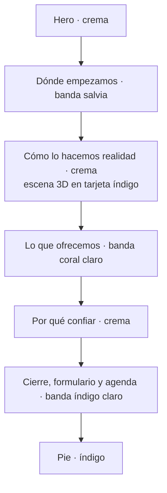

Las bandas de color no llegan al borde de la ventana y tienen esquinas suaves (entre 28 y 48 px).

## Tipografía

| Familia | Uso | Pesos | Archivo | Licencia |
|---|---|---|---|---|
| Fraunces | Títulos y cifras; cursiva para el énfasis | Variable, 100 a 900, con eje de tamaño óptico | `fraunces-latin-opsz-normal.woff2` (67 kB), `fraunces-latin-opsz-italic.woff2` (82 kB) | SIL OFL 1.1 |
| Figtree | Texto e interfaz | Variable, 300 a 900 | `figtree-latin-wght-normal.woff2` (20 kB) | SIL OFL 1.1 |
| DM Mono | Etiquetas, números de etapa, terminal | 400 y 500 | `dm-mono-latin-400-normal.woff2`, `dm-mono-latin-500-normal.woff2` (15 kB cada una) | SIL OFL 1.1 |

- Los archivos y el texto de cada licencia están en [`src/styles/fonts/`](../../src/styles/fonts/). Se sirven desde el propio dominio; el sitio no pide nada a Google Fonts ([ADR-0011](../architecture/adr/0011-fuentes-y-archivos-de-marca-en-el-repositorio.md)).
- Se precargan Fraunces normal y Figtree. El resto llega después del primer pintado.
- Mientras Fraunces carga se usa Times New Roman reescalada al 95 % (87,5 % en cursiva), para que los títulos no cambien de líneas y la página no salte.
- En el código: `font-display`, `font-body` y `font-mono`. Los títulos grandes usan tamaño óptico 144; el logo, 72.
- Subconjunto `latin`: cubre español e inglés.

## Logo

Concepto elegido el 2026-11-14: **cinco tramos, el punto y la IA**.

- **Símbolo:** una «c» construida con cinco tramos, uno por etapa del recorrido; el último en coral. En la abertura, un punto coral: lo que sigue en marcha, el «.ing».
- **Nombre:** «conf» en Fraunces (peso 450), «IA» en mayúscula en Figtree negrita, el punto recto y de acento, e «ing» en cursiva.
- **Favicon reducido:** arco continuo con el punto, para 16 px, donde los cinco tramos se funden.

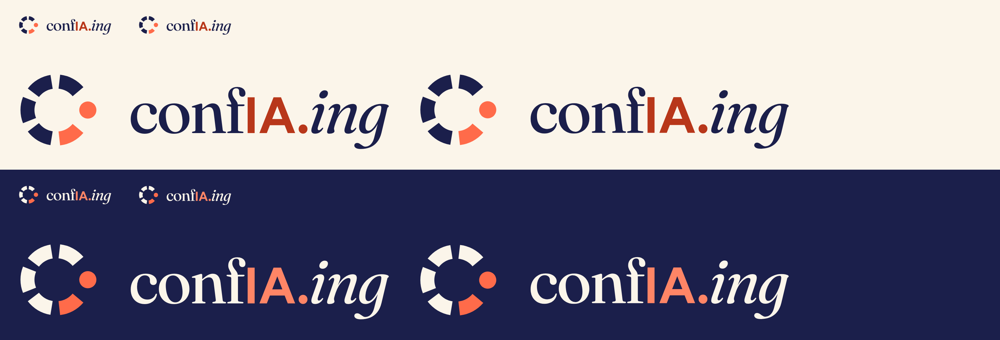

*A la izquierda de cada fila, el componente de la web; a la derecha, el archivo SVG. Deben coincidir.*

### Colores del logo

| Parte | Fondo claro | Fondo oscuro |
|---|---|---|
| Tramos 1 a 4 y nombre | índigo 900 | crema 50 |
| Quinto tramo y punto | coral 500 | coral 500 |
| «IA» y el punto del nombre | coral 700 | coral 300 |

«IA» no usa coral 500 porque, como texto, no alcanza contraste sobre crema.

### Archivos

En [`public/brand/`](../../public/brand/). El nombre está convertido en trazados: se ven igual sin las fuentes instaladas.

| Archivo | Para qué |
|---|---|
| `logo.svg` · `logo-dark.svg` | Versión principal, en horizontal. Fondo claro y fondo oscuro. |
| `logo-compact.svg` · `logo-compact-dark.svg` | Símbolo sobre el nombre, para espacios cuadrados o estrechos. |
| `symbol.svg` · `symbol-dark.svg` | Solo el símbolo, cuando el nombre ya está escrito al lado o no cabe. |
| `favicon.svg` | Favicon reducido sobre ficha crema. |
| `favicon-32.png` · `apple-touch-icon.png` | Favicon de 32 px e icono de 180 px para iOS. |
| `../favicon.ico` | Para navegadores que lo piden por defecto. |

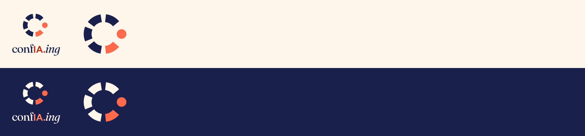

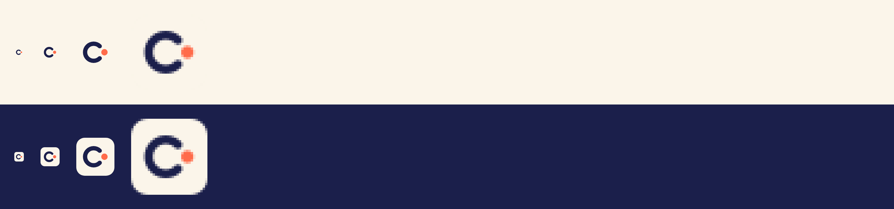

Se regeneran con `npm run brand:build`. En la web se usa el componente [`Logo`](../../src/components/ui/logo.tsx), que toma sus colores del tema.

### Uso

- **Zona de respeto:** alrededor del logo, un margen libre igual al diámetro del punto como mínimo.
- **Tamaño mínimo:** versión principal, 20 px de alto; por debajo, el símbolo; a 16 px, el favicon reducido.
- **Fondos:** versión clara sobre crema, arena, blanco, salvia, mantequilla e índigo 100; versión oscura sobre índigo 900 y 700. Sobre la banda coral no se usan los archivos: el componente de la web toma los colores de ese tema y queda en índigo de un solo color.
- **No se hace:** cambiar los colores, separar o reordenar «conf», «IA» y «.ing», escribir «IA» en minúscula, deformarlo, girarlo, añadirle sombra o contorno, ni colocarlo sobre fotografías.

Pendiente después de la v1: búsqueda de parecidos con marcas registradas antes de registrarlo.

## La escena

Un camino de cinco terrazas —una por etapa— hecho de bloques que pasan de dispersos a ordenados, recorrido por dos esferas: tú y nosotros. Aparece en el hero (el principio, casi todo en el aire), en el recorrido (construido hasta la etapa elegida) y en el cierre (completo).

Tiene dos versiones, que salen del mismo modelo (`src/domain/scene/`) y toman sus colores de los roles `--scene-*` del tema que las contiene:

| Versión | Qué es | Cuándo |
|---|---|---|
| Completa | Escena 3D (Three.js), en un lienzo que se muda a la sección visible | Equipos con WebGL y sin restricciones; se carga después de que la página es legible |
| Ligera | Ilustración SVG isométrica, incluida en el HTML | Sin WebGL, con ahorro de datos, conexión lenta, equipo modesto, movimiento reducido, sin JavaScript, o si la escena falla |

El visitante puede cambiar de versión en el pie de la home.

| | Completa (3D) | Ligera (SVG) |
|---|---|---|
| Hero | 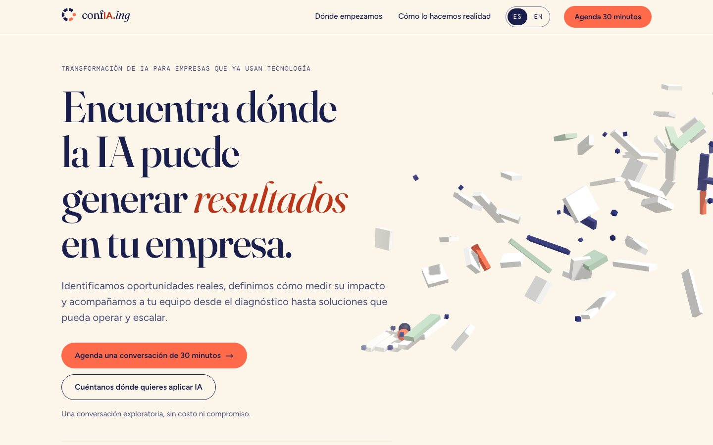 | 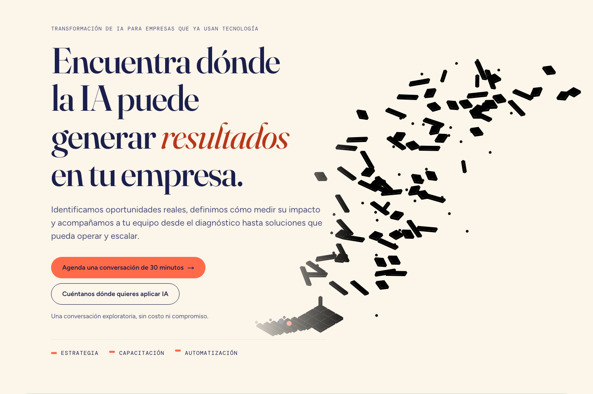 |
| Recorrido | 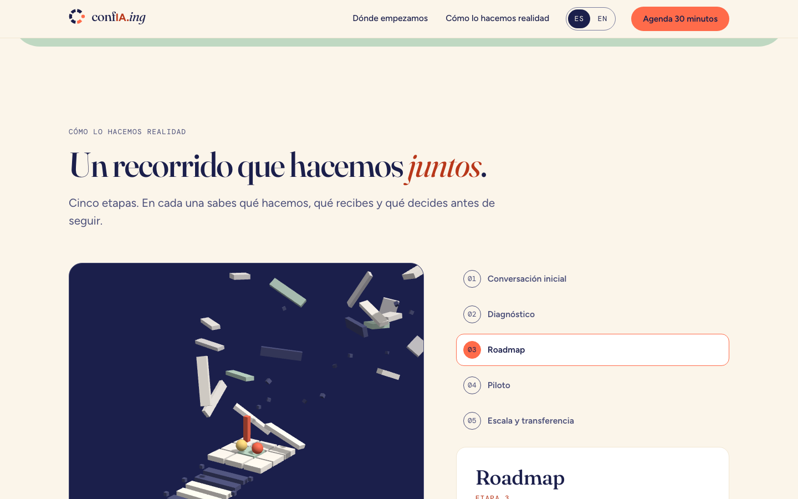 | 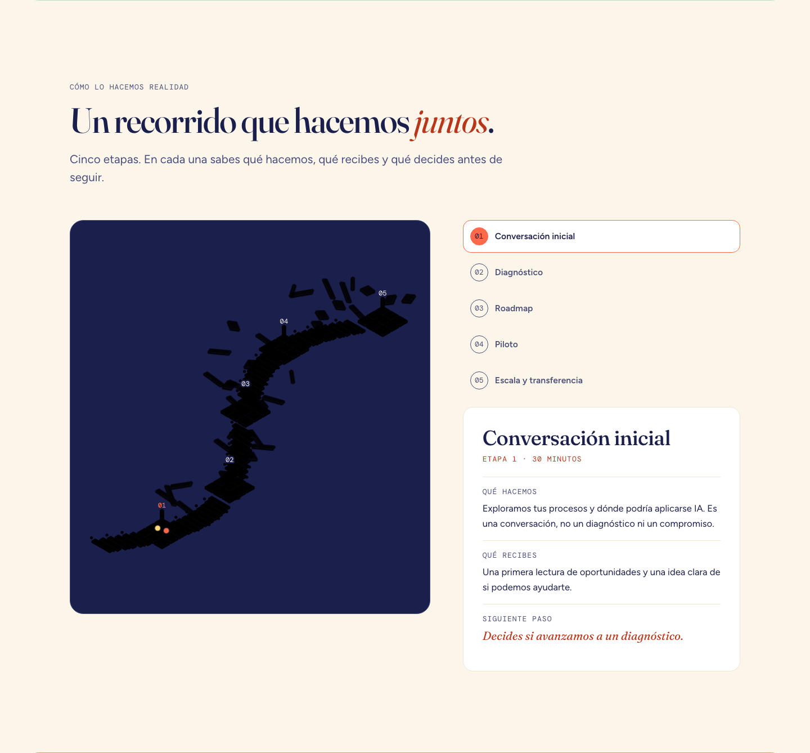 |
| Cierre | 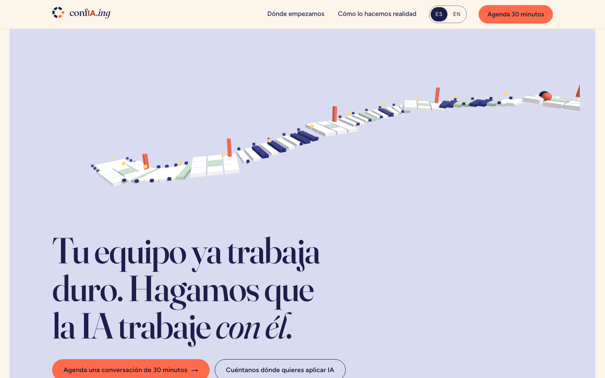 | 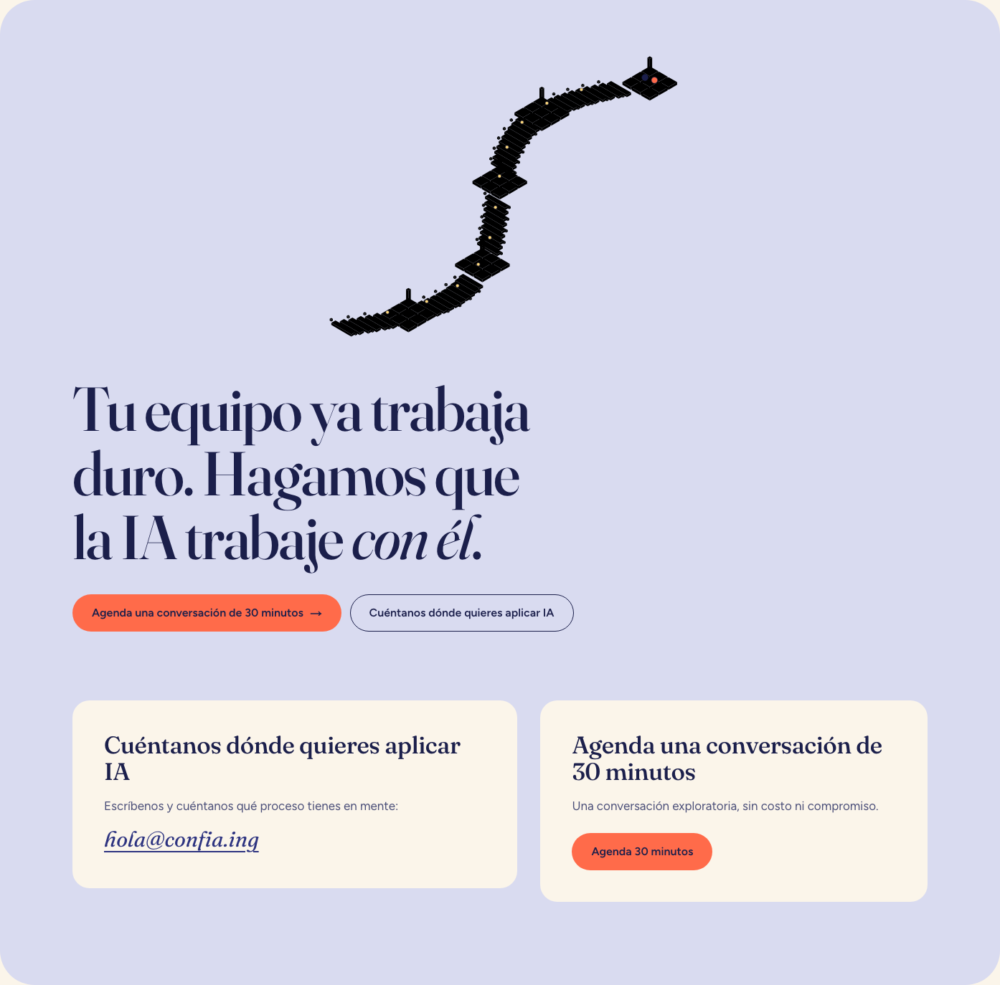 |

## En pantalla

La home, sección a sección (1440 px), en versión ligera. Las capturas se rehacen con `node scripts/capture-brand-shots.ts` y la app servida en local.

| Sección | Captura |
|---|---|
| Hero · crema |  |
| Dónde empezamos · banda salvia, tarjeta mantequilla | 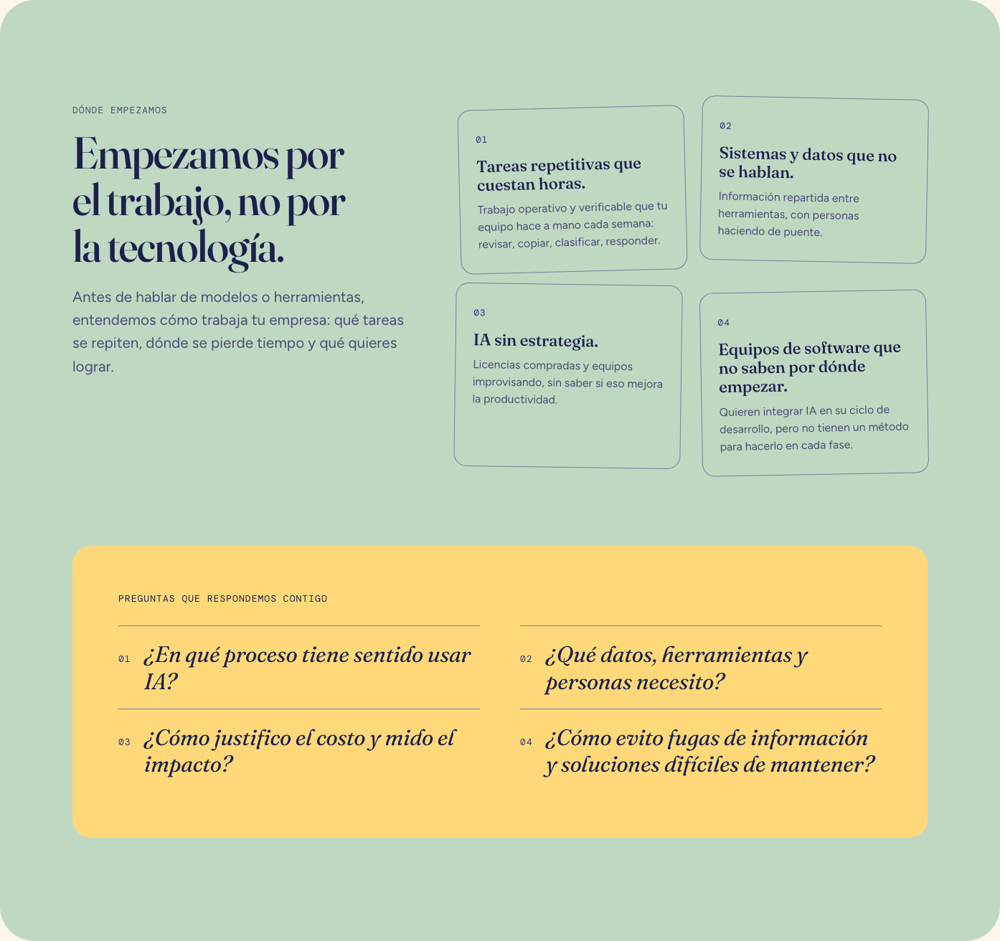 |
| Cómo lo hacemos realidad · crema |  |
| Lo que ofrecemos · banda coral claro, tarjeta índigo | 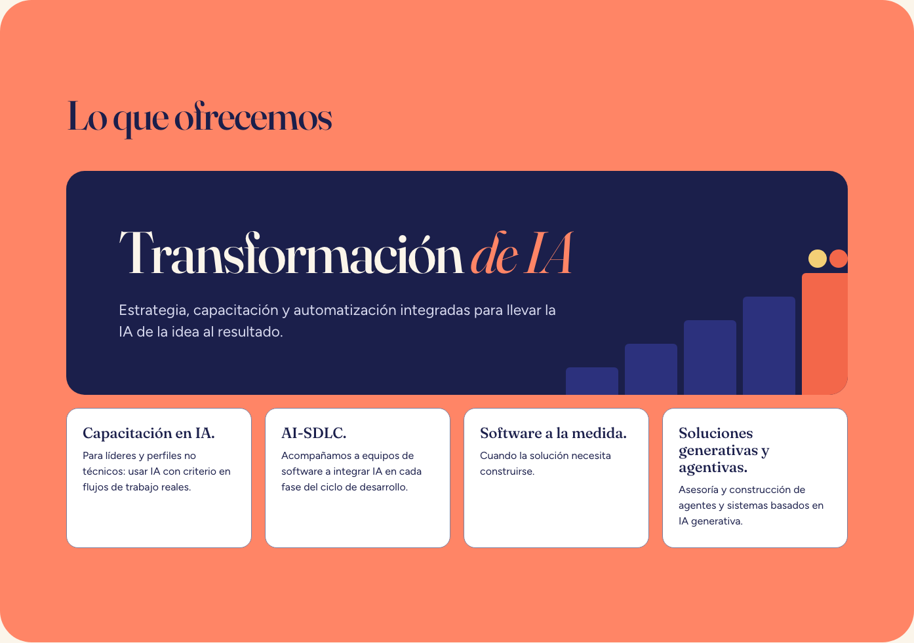 |
| Por qué confiar · crema | 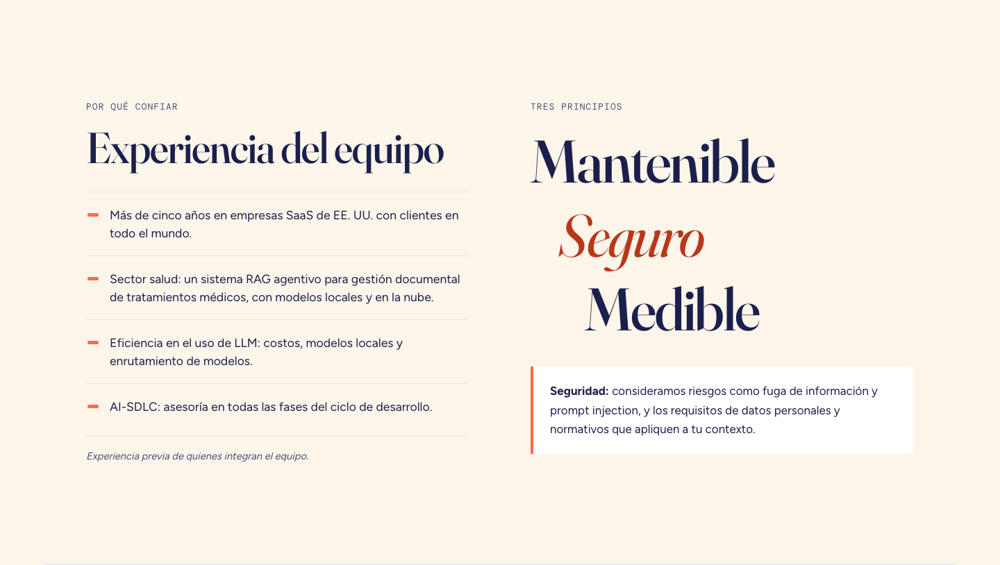 |
| Cierre · banda índigo claro |  |

En móvil (390 px): [hero](img/home-hero-mobile.png) · [dónde empezamos](img/home-start-mobile.png) · [etapas](img/home-journey-mobile.png) · [servicios](img/home-offer-mobile.png) · [confianza](img/home-trust-mobile.png) · [cierre](img/home-closing-mobile.png) · [menú](img/menu-mobile.png).

Otras páginas: [página legal](img/legal-desktop.png) · [404](img/not-found-mobile.png).

## Componentes base

En [`src/components/ui/`](../../src/components/ui/): `Button` y `ButtonLink` (primario, secundario; 52 y 44 px), `TextLink`, `Field`, `Checkbox`, `Card` y `Notice`. Todos toman el color del tema que los contiene y ninguno lleva JavaScript de cliente.

## Imagen

- **Ilustración:** bloques isométricos que pasan de dispersos a formar un camino, con dos esferas (tú y nosotros). Color plano, contorno índigo fino.
- **Iconos:** trazo redondeado de 1,75 px en índigo, con un solo elemento en coral.
- **Diagramas:** una línea con paradas numeradas; lo recorrido en coral.
- **No se usa:** robots, cerebros, redes neuronales, degradados «de IA», fotografía de archivo.

## Formulario

Dos modos a elección del visitante: terminal (índigo, con tecleo animado) y clásico (con un panel `consulta.json` que se escribe en vivo). Ver [ADR-0010](../architecture/adr/0010-formulario-en-dos-modos.md).
