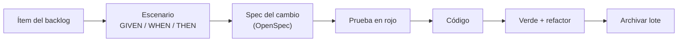

# Escenarios de aceptación

Guía de implementación de cada ítem del [BACKLOG.md](../BACKLOG.md). Cada escenario es una prueba que debe existir y fallar antes de escribir el código que la hace pasar.

**Cómo se usa**

1. Al abrir un lote con `/opsx:propose`, sus escenarios se copian a `openspec/changes/<lote>/specs/<capacidad>/spec.md` como requisitos `SHALL` con sus `#### Scenario`.
2. Cada escenario se verifica en el nivel indicado: **U** unitario, **I** integración, **E** E2E, **C** contrato, **M** manual.
3. Los de nivel **U, I y E** son pruebas automáticas con ciclo TDD: prueba en rojo → implementación mínima → verde → refactor.
4. Los de nivel **C** se ejecutan con `npm run test:contract` contra Supabase local; los de nivel **M** se ejecutan a mano. En ambos casos la evidencia (comando y salida) se anota en el `tasks.md` del cambio.
5. Las pruebas que deben hacer fallar el lint o el tipado usan archivos de `tests/fixtures/`, fuera del alcance normal de ESLint y `tsc`.
6. Si al implementar aparece un comportamiento no cubierto, primero se añade aquí su escenario.

Las palabras clave GIVEN / WHEN / THEN / AND se mantienen en inglés, como en OpenSpec.

---

## L0 — Cimientos

**L0-1 · Guía de trabajo** — M
- GIVEN `CLAUDE.md` y `openspec/config.yaml` WHEN se revisan THEN `CLAUDE.md` tiene menos de 200 líneas AND ambos fueron aprobados por el fundador antes de escribir código.

**L0-2 · Proyecto base** — E
- GIVEN el proyecto recién instalado WHEN se ejecuta `npm run dev` THEN `/es` responde 200 con `lang="es"` AND `/en` responde 200 con `lang="en"`.
- GIVEN el build de producción WHEN se ejecuta `npm run preview` THEN la misma página responde 200 en el runtime de Workers.

**L0-3 · Herramientas de prueba** — U, I, E
- GIVEN una prueba de humo en cada nivel WHEN se ejecutan `npm test` y `npm run e2e` THEN ambas terminan con código 0 AND informan al menos una prueba ejecutada por nivel.

**L0-4 · Reglas de arquitectura** — U (lint)
- GIVEN un archivo de dominio de `tests/fixtures/` que importa cualquier paquete distinto de `zod` (`next`, `react`, `@supabase/supabase-js`, `three`) WHEN se le aplican las reglas de lint del dominio THEN se informa un error en ese import.
- GIVEN un archivo de dominio que importa `zod` WHEN se le aplican las reglas THEN no hay errores.
- GIVEN un componente de `tests/fixtures/` con un color literal (`#FF6B4A`, `rgb(...)`) WHEN se le aplican las reglas de `src/` THEN se informa un error en esa línea AND `transparent` y `currentColor` no lo provocan.
- GIVEN un componente que importa `src/adapters/` o `src/lib/server/` WHEN se le aplican las reglas THEN se informa un error.

**L0-5 · Variables de entorno** — U
- GIVEN `SERVICES=real` y que falta `SUPABASE_SECRET_KEY` WHEN se cargan las variables del servidor THEN se lanza un error que nombra la variable AND no muestra el valor de ninguna otra.
- GIVEN `SERVICES=memory` y ningún secreto definido WHEN se cargan THEN no hay error AND las dependencias resueltas son los adaptadores en memoria.
- GIVEN `SERVICES` ausente WHEN se cargan THEN se asume `memory`.

**L0-6 · Supabase local** — M
- GIVEN Docker en ejecución WHEN se ejecuta `npx supabase start` THEN la base local queda disponible AND `npx supabase migration list` no muestra pendientes.

**L0-7 · Tamaño del Worker** — U
- GIVEN un tamaño medido superior a 3 MiB WHEN corre la comprobación de tamaño THEN termina con código distinto de 0 AND muestra tamaño medido y límite.
- GIVEN un tamaño medido inferior WHEN corre THEN termina con código 0 AND muestra el margen restante.

**L0-8 · ADR y estructura** — M
- GIVEN el repositorio WHEN se listan las carpetas THEN existen `src/domain/scene/`, `src/lib/server/` y `tests/fixtures/` AND los ADR 0009 y 0010 figuran como aceptados.

## L1 — Marca y sistema de interfaz

**L1-1 · Tokens centralizados** — U, I
- GIVEN `tokens.css` WHEN se leen sus primitivos THEN son exactamente los 15 colores de la paleta elegida, sin valores adicionales.
- GIVEN un componente renderizado dentro de `.theme-dark` WHEN se cambia `--color-primary` en `tokens.css` THEN el componente refleja el nuevo valor sin modificar su código.

**L1-2 · Contraste** — U
- GIVEN cada pareja texto/fondo declarada como permitida en cada tema WHEN se calcula su contraste THEN es ≥ 4,5:1 para texto normal AND ≥ 3:1 para texto grande y elementos gráficos.

**L1-3 · Tipografías** — I, E
- GIVEN la home cargada WHEN se inspeccionan las peticiones THEN las fuentes se sirven desde el propio dominio AND ninguna va a `fonts.googleapis.com`.
- GIVEN el texto «Capacitación · Diagnóstico · ¿Dónde?» WHEN se renderiza THEN los acentos y signos se muestran con la fuente declarada, no con la de respaldo.

**L1-4 y L1-8 · Logotipo** — I
- GIVEN el componente `Logo` WHEN se renderiza THEN muestra el símbolo de cinco tramos con el punto AND el nombre con «IA» resaltada AND expone el nombre accesible que recibe.
- GIVEN los archivos de `public/brand/` WHEN se listan THEN incluyen el favicon reducido (arco continuo con punto) en SVG y en 32 px.

**L1-5 · Componentes base** — I
- GIVEN un botón primario WHEN recibe foco por teclado THEN muestra un anillo de foco visible con contraste ≥ 3:1.
- GIVEN un campo con error WHEN se renderiza THEN tiene `aria-invalid="true"` AND su mensaje está asociado por `aria-describedby`.
- GIVEN un botón deshabilitado WHEN se pulsa THEN no dispara su acción.

**L1-6 · Guía de marca** — M
- GIVEN `docs/brand/` WHEN se revisa THEN documenta paleta con HEX y roles, tipografías con licencia, versiones del logo y ejemplos en móvil y escritorio.

**L1 · Escenarios añadidos al proponer el lote** — detalle en `openspec/changes/l1-marca-y-sistema-de-interfaz/specs/`
- (L1-1, U) GIVEN los temas por banda WHEN se resuelve `--color-background` THEN es el fondo acordado en cada uno AND cada tema define todos los roles `--color-*`.
- (L1-1, U) GIVEN el bloque de tema de Tailwind WHEN se inspecciona THEN la paleta por defecto está anulada.
- (L1-2, U) GIVEN blanco sobre coral 500 WHEN se evalúa THEN el verificador informa «no cumple» con tema, roles y contraste.
- (L1-3, E) GIVEN la home con la red limitada WHEN cargan las fuentes THEN CLS < 0,1 AND hay como máximo dos fuentes precargadas.
- (L1-3, U) GIVEN la carpeta de fuentes WHEN se lista THEN hay una licencia OFL por familia.
- (L1-4, U) GIVEN los SVG de `public/brand/` WHEN se analizan THEN no tienen texto ni recursos externos AND sus colores son de la paleta AND regenerarlos da un resultado idéntico.
- (L1-4, E) GIVEN `/es` y `/en` WHEN se piden los iconos declarados y `/favicon.ico` THEN responden 200.
- (L1-4, M) GIVEN el favicon a 16 px sobre claro y oscuro WHEN se revisa THEN arco y punto se distinguen.
- (L1-5, I) GIVEN un botón WHEN se activa con Enter o Espacio THEN su acción se dispara una vez.
- (L1-5, I) GIVEN un enlace externo WHEN se renderiza THEN lleva `rel="noopener noreferrer"` AND anuncia la nueva pestaña.
- (L1-5, I) GIVEN una casilla con foco WHEN se pulsa Espacio THEN cambia de estado.
- (L1-5, I) GIVEN un aviso de error WHEN se renderiza THEN tiene `role="alert"`; uno de éxito, `role="status"`.
- (L1-5, I) GIVEN cada componente en cada estado WHEN se analiza con axe THEN no hay infracciones.
- (L1-5, E) GIVEN movimiento reducido WHEN se pulsa un botón THEN no se desplaza.
- (L1-6, U) GIVEN la tabla de paleta de la guía WHEN se compara con `tokens.css` THEN nombres y HEX coinciden.

## L2 — Idiomas y estructura

**L2-1 · Llegar en mi idioma** — U, I
- GIVEN una petición a `/` sin cookie con `Accept-Language: en-US,en;q=0.9` WHEN responde THEN redirige a `/en`.
- GIVEN una petición a `/` sin cookie con `Accept-Language: fr-FR` WHEN responde THEN redirige a `/es`.
- GIVEN la cookie `locale=en` y `Accept-Language: es` WHEN se pide `/` THEN redirige a `/en`.
- GIVEN una petición directa a `/en` con `Accept-Language: es` WHEN responde THEN sirve `/en` sin redirigir.

**L2-2 · Cambiar de idioma** — I, E
- GIVEN el visitante en `/es/privacidad` WHEN elige EN THEN llega a `/en/privacy` AND la cookie `locale` vale `en`.
- GIVEN que eligió EN WHEN vuelve a `/` THEN es llevado a `/en`.

**L2-3 · Diccionarios tipados** — U
- GIVEN una clave presente en `es.ts` y ausente en `en.ts` WHEN se ejecuta `npm run typecheck` THEN falla nombrando la clave.

**L2-4 · Cabecera** — I, E
- GIVEN la página cargada WHEN se pulsa Tab una vez THEN el foco está en «Saltar al contenido».
- GIVEN un ancho de 375 px WHEN se abre el menú y se pulsa Escape THEN el menú se cierra AND el foco vuelve al botón de menú.
- GIVEN cualquier ancho WHEN se mira la cabecera THEN el CTA de agenda es alcanzable (visible o dentro del menú).

**L2-5 · Pie** — I
- GIVEN el pie en `/en` WHEN se renderiza THEN muestra `hola@confia.ing` como texto AND los enlaces legales apuntan a `/en/privacy` y `/en/terms`.

**L2-7 · Rutas legales provisionales** — I
- GIVEN `/es/privacidad`, `/en/privacy`, `/es/terminos` y `/en/terms` WHEN se solicitan THEN responden 200 con título en su idioma y aviso de borrador.
- GIVEN un cruce de idioma y slug (`/es/privacy`) WHEN se solicita THEN responde 404.

**L2-6 · 404** — I
- GIVEN una ruta inexistente bajo `/en/` WHEN se solicita THEN responde 404 con texto en inglés AND un enlace a `/en`.

**L2 · Escenarios añadidos al proponer el lote** — detalle en `openspec/changes/l2-idiomas-y-estructura/specs/`
- (L2-1, I) GIVEN `/` sin cookie ni `Accept-Language` WHEN responde THEN redirige a `/es`; con cookie `locale=fr` THEN la cookie se ignora.
- (L2-1, I) GIVEN cualquier petición a `/` WHEN responde THEN es una redirección temporal que no se guarda en cachés compartidas.
- (L2-1, U) GIVEN `Accept-Language` con pesos, variante regional (`es-CO`), comodín, `q=0` o mal formado WHEN se negocia THEN se elige el idioma admitido de mayor peso o español.
- (L2-2, U) GIVEN una ruta de un idioma WHEN se pide su equivalente THEN home↔home, privacidad↔privacy, términos↔terms AND una ruta desconocida lleva a la home.
- (L2-2, E) GIVEN JavaScript desactivado WHEN se elige EN THEN se llega a `/en` AND la cookie `locale` vale `en`.
- (L2-2, I) GIVEN un cambio de idioma con origen externo o idioma no admitido WHEN responde THEN nunca redirige fuera del sitio AND no guarda cookie si el idioma no es válido.
- (L2-2, I) GIVEN un cambio a `en` WHEN se inspecciona la cookie THEN vale `en` con `Path=/`, un año y `SameSite=Lax`.
- (L2-2, I) GIVEN el selector WHEN se renderiza THEN el idioma activo está señalado AND el otro es un enlace con `hreflang` y `lang`.
- (L2-1, E) GIVEN cualquier página WHEN se lee su cabecera HTML THEN declara canónica y alternos `es`, `en` y `x-default` hacia su equivalente.
- (L2-3, U) GIVEN una clave presente solo en `en.ts` WHEN se comprueban los tipos THEN falla nombrándola AND los diccionarios reales no tienen textos vacíos.
- (L2-3, E) GIVEN `/en` y `/en/privacy` WHEN se lee su texto THEN no aparece ninguna frase del diccionario español.
- (L2-4, E) GIVEN el foco en «Saltar al contenido» WHEN se pulsa Enter THEN el foco pasa al contenido principal.
- (L2-4, I) GIVEN la cabecera en una página legal WHEN se renderiza THEN las anclas apuntan a la home.
- (L2-4, I) GIVEN la acción de agenda WHEN se renderiza THEN es un enlace directo al calendario, en otra pestaña y con aviso.
- (L2-4, I, E) GIVEN el menú WHEN se abre, se cierra o se elige un enlace THEN `aria-expanded` lo refleja AND cerrado sus enlaces no reciben foco.
- (L2-4, E) GIVEN JavaScript desactivado en 375 px WHEN carga la página THEN anclas, selector y agenda están visibles.
- (L2-4, E) GIVEN cualquier página WHEN se inspecciona THEN hay un solo `banner`, `main` y `contentinfo` AND axe no encuentra infracciones.
- (L2-4, E) GIVEN `/es` con el marco WHEN se mide THEN JS inicial ≤ 200 kB AND CLS < 0,1.
- (L2-7, E) GIVEN una página legal WHEN se lee su cabecera THEN declara `noindex` AND su título nombra la página y la marca.
- (L2-6, E) GIVEN cualquier ruta inexistente (`/en/x`, `/es/a/b/c`, `/es/privacy`, `/fr`) WHEN se solicita THEN responde 404 con una página bilingüe: cada mensaje con su `lang` y un enlace a su home AND declara `noindex`.
- (L2-6, E) GIVEN una 404 WHEN se lee el HTML servido o se abre con los scripts desactivados THEN el mensaje y los enlaces están presentes.
- (L2-1, I) GIVEN `/?utm_source=boletin` WHEN responde THEN redirige conservando la consulta.
- (L2-2, I) GIVEN un cambio de idioma en un host que no es local WHEN se inspecciona la cookie THEN lleva `Secure`.
- (L2-4, I, E) GIVEN el menú abierto WHEN el foco sale hacia la página o la ventana se ensancha THEN se cierra.

## L3 — Contenido de la home

**L3-1 · Hero** — I
- GIVEN el hero WHEN se renderiza THEN hay un único `h1` AND dos CTA con estilos distintos (primario y secundario).
- GIVEN el texto bajo los CTA WHEN se lee THEN describe la conversación como exploratoria, sin costo ni compromiso AND no contiene la palabra «diagnóstico».
- GIVEN JavaScript desactivado WHEN carga la página THEN el título, el texto y los dos CTA son visibles AND el CTA de agenda enlaza directamente a Calendly AND el de consulta lleva a un bloque que muestra `hola@confia.ing`.

**L3-2 · Dónde empezamos** — I
- GIVEN la sección WHEN se renderiza THEN muestra cuatro fricciones y cuatro preguntas AND ninguna menciona un sector o industria.

**L3-3 · Servicios con jerarquía** — I
- GIVEN la sección WHEN se renderiza THEN «Transformación de IA» ocupa una tarjeta propia de mayor tamaño AND los otros cuatro servicios aparecen después, en el orden del PRD §5.

**L3-4 · Credibilidad** — I
- GIVEN la sección WHEN se lee THEN contiene las cuatro evidencias del PRD §7 AND la nota «Experiencia previa de quienes integran el equipo» AND ningún nombre de empresa, logo, cifra de impacto ni testimonio.

**L3-5 · Seguridad** — I
- GIVEN el texto de seguridad WHEN se lee en ES y EN THEN habla de riesgos considerados AND no contiene «certificado», «cumple», «garantiza» ni sus equivalentes en inglés.

**L3-6 · Cierre** — I
- GIVEN el cierre WHEN se renderiza THEN repite los dos CTA del hero con los mismos destinos.

**L3-7 · Redacción EN** — U, M
- GIVEN los diccionarios WHEN se comparan THEN toda clave de `es` tiene valor no vacío en `en` AND ninguno es idéntico al español salvo nombres propios.

**L3-8 · Ritmo de secciones** — I
- GIVEN la home WHEN se recorren sus secciones en orden THEN alternan fondo crema y banda de color: salvia, crema, coral claro, crema, índigo claro.
- GIVEN una banda de color WHEN se mide THEN no toca los bordes de la ventana AND tiene esquinas redondeadas.

**L3 · Escenarios añadidos al proponer el lote** — detalle en `openspec/changes/l3-contenido-de-la-home/specs/`
- (L3, I) GIVEN la home WHEN se listan sus secciones THEN son seis, en orden, cada una con su título AND hay un solo `h1` sin saltos de nivel.
- (L3, E) GIVEN la cabecera WHEN se pulsan sus anclas THEN cada una deja el título de su sección visible bajo la cabecera fija.
- (L3-1, I) GIVEN el hero WHEN se renderiza THEN lista los tres pilares en orden.
- (L3-2, I) GIVEN «Dónde empezamos» WHEN se inspecciona THEN fricciones y preguntas son listas ordenadas de cuatro elementos.
- (L3, I, E) GIVEN «Cómo lo hacemos realidad» WHEN se renderiza THEN muestra las cinco etapas con qué hacemos, qué recibes y el paso siguiente AND la primera dice que no es un diagnóstico AND están en el HTML servido.
- (L3-3, E) GIVEN «Lo que ofrecemos» a 1280 px WHEN se miden las tarjetas THEN la del servicio principal tiene más área y mayor título.
- (L3-4, I) GIVEN «Por qué confiar» WHEN se renderiza THEN la nota de atribución va después de las evidencias AND se listan los tres principios.
- (L3-6, I, E) GIVEN el cierre WHEN se renderiza THEN el bloque de consulta muestra `hola@confia.ing` AND el de agenda enlaza al calendario AND la acción de consulta del hero lleva a su bloque.
- (L3-8, E) GIVEN la home WHEN se leen los fondos THEN la tarjeta de preguntas es mantequilla y la del servicio principal índigo 900.
- (L3, E) GIVEN la home a 375 px en ES y EN WHEN se mide THEN no hay desplazamiento horizontal AND LCP < 2,5 s, CLS < 0,1 y JS ≤ 200 kB AND con movimiento reducido nada se desplaza.
- (L3-5, U) GIVEN todos los textos de ambos diccionarios WHEN se buscan palabras de certificación, cumplimiento o garantía THEN no aparece ninguna.
- (L3-1, U) GIVEN las acciones de agenda y su nota WHEN se leen THEN no contienen «diagnóstico» ni «assessment».
- (L3-4, U) GIVEN todos los textos WHEN se buscan porcentajes, monedas y multiplicadores THEN no hay ninguno AND los números presentes son los de una lista cerrada.
- (L3-4, U) GIVEN todos los textos WHEN se buscan sellos y normas, clientes o prueba social, plazos de respuesta y cifras escritas con letra THEN no hay ninguno.
- (L3, U) GIVEN los diccionarios WHEN se buscan asteriscos THEN solo aparecen, y por pares, en los títulos que los interpretan.
- (L3-3, E) GIVEN «Lo que ofrecemos» a 639, 700, 1099, 1100 y 1280 px WHEN se cuentan las columnas de los servicios subordinados THEN son 1, 2, 2, 4 y 4.
- (L3, E) GIVEN un texto en cursiva con la fuente de títulos WHEN se lee su familia THEN es el archivo cursivo de Fraunces, no la recta inclinada.
- (L3, E) GIVEN la home a 320 y 375 px en ES y EN WHEN se mide cada texto THEN ninguno se sale de la ventana ni se recorta.

## L4 — Recorrido interactivo

**L4-1 · Cinco etapas** — I
- GIVEN el recorrido WHEN se selecciona la etapa 3 THEN se muestra «Roadmap» con sus tres partes: qué hacemos, qué recibes y siguiente paso.
- GIVEN la etapa 1 WHEN se lee THEN dice que es una conversación de 30 minutos AND que no es un diagnóstico ni un compromiso.

**L4-2 · Navegación accesible** — I, E
- GIVEN el foco en la pestaña 1 WHEN se pulsa Flecha derecha THEN se selecciona la pestaña 2 AND recibe el foco.
- GIVEN el foco en la pestaña 5 WHEN se pulsa Flecha derecha THEN se selecciona la 1.
- GIVEN cualquier pestaña WHEN se pulsa Fin THEN se selecciona la 5; WHEN se pulsa Inicio THEN la 1.
- GIVEN el recorrido WHEN lo analiza axe THEN no hay infracciones AND cada pestaña expone `aria-selected` y `aria-controls`.

**L4-3 · Sin JavaScript** — E
- GIVEN JavaScript desactivado WHEN carga la home THEN el contenido de las cinco etapas es visible y legible en orden.

**L4-4 · Movimiento reducido** — E
- GIVEN `prefers-reduced-motion: reduce` WHEN se cambia de etapa THEN el panel cambia sin transición AND la escena se muestra en versión ligera.

**L4-5 · Móvil** — E
- GIVEN un ancho de 375 px WHEN se recorre la home THEN no hay desplazamiento horizontal AND todo control táctil mide al menos 44×44 px.

**L4-6 · Avance por desplazamiento** (prioridad C) — E
- GIVEN el modo completo WHEN el visitante desplaza la página por el recorrido THEN la cámara acompaña el avance AND el desplazamiento nativo nunca se bloquea ni se secuestra.

**L4-7 · Versión ligera** — U, E
- GIVEN un entorno sin WebGL WHEN se decide el modo THEN es «ligero».
- GIVEN `saveData` activo, conexión `3g`, memoria ≤ 2 GB o `prefers-reduced-motion` WHEN se decide el modo THEN es «ligero» AND el motivo queda disponible para mostrarlo.
- GIVEN el modo ligero WHEN carga la home THEN no se solicita el archivo de Three.js AND cada ranura muestra el SVG de la escena.

**L4-8 · Escena 3D** — U, E
- GIVEN el modelo de la escena y la etapa 3 WHEN se calcula el estado THEN los tramos 1 a 3 están construidos AND los 4 y 5 dispersos.
- GIVEN el modo completo WHEN la página termina de cargar THEN Three.js se solicita después del evento `load` AND no hay errores de consola.
- GIVEN la escena activa WHEN la pestaña del navegador se oculta THEN se detiene el bucle de render.
- GIVEN que falla la carga de Three.js WHEN se detecta THEN la página pasa a modo ligero AND lo comunica en el pie.

**L4-9 · Control de versión** — I, E
- GIVEN el modo completo WHEN el visitante elige «Versión ligera» THEN la escena pasa a SVG al instante AND la preferencia se recuerda al recargar.
- GIVEN un navegador sin WebGL WHEN elige «Versión completa» THEN permanece en ligera AND se explica el motivo.

## L5 — Consulta por formulario

**L5-1 · Envío de consulta** — U, I, E
- GIVEN nombre, correo válido, mensaje y consentimiento WHEN se envía THEN la consulta es aceptada.
- GIVEN nombre, teléfono válido y consentimiento, sin correo WHEN se envía THEN es aceptada.
- GIVEN nombre y consentimiento, sin correo ni teléfono WHEN se envía THEN es rechazada con el error «correo o teléfono, al menos uno».
- GIVEN un correo sin dominio WHEN se valida THEN es rechazado con un mensaje que explica el formato esperado.

**L5-2 · Consentimiento** — I
- GIVEN el formulario recién cargado WHEN se inspecciona la casilla THEN no está marcada AND su texto enlaza a la política de privacidad.
- GIVEN todos los campos válidos y la casilla sin marcar WHEN se envía THEN es rechazada AND no se guarda nada.
- GIVEN una consulta aceptada WHEN se guarda THEN registra fecha del consentimiento AND versión del aviso aceptado.

**L5-3 · Errores accesibles** — I
- GIVEN un envío con dos campos inválidos WHEN se muestran los errores THEN cada uno aparece junto a su campo AND el foco va al primero AND lo ya escrito se conserva.
- GIVEN un error visible WHEN el visitante corrige el campo THEN el error desaparece.

**L5-4 · Confirmación** — I
- GIVEN un envío aceptado WHEN responde el servidor THEN se muestra «Recibimos tu consulta. Te contactaremos pronto.» en una región `role="status"` AND el texto no promete un plazo.

**L5-5 · `POST /api/contact`** — I
- GIVEN un cuerpo válido con token de Turnstile válido WHEN se envía THEN responde 201 AND el repositorio recibió exactamente una consulta.
- GIVEN un cuerpo que el cliente no habría permitido (sin contacto) WHEN se envía directamente THEN responde 422 con errores por campo en el idioma indicado AND no se guarda nada.
- GIVEN una petición con `Origin` distinto del sitio o `Content-Type` que no es JSON WHEN llega THEN responde 4xx AND no se guarda nada.

**L5-6 · Tabla `contact_requests`** — C
- GIVEN la migración aplicada en Supabase local WHEN se consulta la tabla con la publishable key THEN no devuelve filas AND rechaza inserciones.
- GIVEN una inserción con la secret key sin correo ni teléfono WHEN se ejecuta THEN la base la rechaza por restricción.

**L5-7 · Antispam** — I
- GIVEN un token de Turnstile inválido WHEN se envía THEN responde 403 AND no se guarda ni se notifica.
- GIVEN el campo trampa relleno WHEN se envía THEN responde 201 AND no se guarda ni se notifica.
- GIVEN más envíos que el límite desde un mismo origen WHEN llega el siguiente THEN responde 429.
- GIVEN cualquier envío WHEN se guarda THEN la fila no contiene la dirección IP.

**L5-8 · Aviso por correo** — I
- GIVEN una consulta guardada con correo WHEN se notifica THEN el aviso va a la dirección configurada, en texto plano, con `Reply-To` del visitante.
- GIVEN que el envío del aviso falla WHEN termina la petición THEN la respuesta sigue siendo 201 AND la consulta permanece guardada AND el fallo queda registrado sin datos personales.

**L5-9 · Degradación** — I
- GIVEN que el repositorio no está disponible WHEN se envía THEN responde 503 AND el formulario muestra un error que ofrece escribir a `hola@confia.ing` AND conserva lo escrito.

**L5-10 · Dos modos** — I, E
- GIVEN el formulario WHEN carga THEN está en modo terminal AND ofrece cambiar a modo clásico.
- GIVEN texto escrito en modo terminal WHEN se cambia a modo clásico THEN los mismos valores aparecen en sus campos.
- GIVEN un envío sin contacto WHEN se hace en cada modo THEN ambos muestran el mismo error.
- GIVEN `prefers-reduced-motion: reduce` WHEN el modo terminal entra en pantalla THEN el comando aparece completo, sin tecleo animado.
- GIVEN el modo clásico WHEN el visitante escribe `<b>x</b>` en el mensaje THEN el panel JSON lo muestra como texto, sin interpretarlo como marcado.

## L6 — Agenda

**L6-1 · Reservar** — I, E
- GIVEN la home recién cargada WHEN se inspeccionan las peticiones THEN ninguna va a `calendly.com`.
- GIVEN el visitante en `/en` WHEN pulsa el CTA de agenda THEN se abre el calendario de Calendly en inglés.

**L6-2 · Alternativa** — I
- GIVEN que el calendario no carga en el tiempo de espera WHEN vence THEN se muestra un mensaje con un enlace directo a Calendly AND un acceso al formulario.

**L6-3 · Confirmación** — I
- GIVEN el calendario abierto WHEN llega el mensaje `calendly.event_scheduled` THEN se muestra la confirmación con los próximos pasos.

**L6-4 · Diálogo accesible** — I, E
- GIVEN el diálogo abierto WHEN se pulsa Tab repetidamente THEN el foco no sale del diálogo.
- GIVEN el diálogo abierto WHEN se pulsa Escape THEN se cierra AND el foco vuelve al CTA que lo abrió.

## L7 — Analítica

**L7-1 · Visitas** — I
- GIVEN el token de Web Analytics vacío WHEN se renderiza la página THEN no se incluye el script.
- GIVEN el token presente WHEN se renderiza THEN se incluye el script AND no se crea ninguna cookie.

**L7-2 · `POST /api/events`** — U, I
- GIVEN un evento `cta_schedule_click` WHEN se envía THEN responde 204 AND se guarda.
- GIVEN un evento con nombre fuera de la lista cerrada WHEN se envía THEN responde 400 AND no se guarda.
- GIVEN un evento con campos no previstos (`email`, `message`) WHEN se envía THEN esos campos se descartan.

**L7-3 · Tabla `analytics_events`** — C
- GIVEN la migración aplicada WHEN se inspecciona el esquema THEN no existe columna para IP, identificador de visitante ni texto libre AND la tabla no es legible con la publishable key.

**L7-4 · Instrumentación** — I
- GIVEN una visita con `?utm_source=linkedin` desde un móvil en `/en` WHEN se pulsa el CTA de consulta THEN se registra `cta_contact_click` con idioma `en`, dispositivo `mobile` y `utm_source=linkedin`.
- GIVEN el formulario en modo terminal WHEN se escribe por primera vez en un campo THEN se registra `form_started` una sola vez, con `form_mode=terminal`.
- GIVEN un envío aceptado WHEN termina THEN se registra `form_submitted` AND el evento no contiene ningún valor de los campos.

**L7-5 · Consultas de conversión** — M
- GIVEN eventos de ejemplo WHEN se ejecutan las consultas documentadas THEN devuelven conversión por idioma, dispositivo, canal y modo de formulario.

## L8 — Legal y SEO

**L8-1 y L8-2 · Textos legales** — I
- GIVEN `/es/privacidad` y `/en/privacy` WHEN se renderizan THEN muestran un aviso visible de «borrador pendiente de revisión legal» AND cubren finalidad, datos tratados, retención, derechos y canal de atención.
- GIVEN `/es/terminos` y `/en/terms` WHEN se renderizan THEN existen AND muestran el mismo aviso de borrador.

**L8-3 · Metadatos** — I
- GIVEN `/es` WHEN se leen sus metadatos THEN tiene título y descripción en español, `canonical` propio y `hreflang` para `es`, `en` y `x-default`.

**L8-4 · Sitemap y robots** — I
- GIVEN `/sitemap.xml` WHEN se solicita THEN lista las seis rutas públicas con sus alternativas de idioma.
- GIVEN `/robots.txt` WHEN se solicita THEN permite el rastreo AND referencia el sitemap.

**L8-5 · Datos estructurados** — I
- GIVEN la home WHEN se extrae su JSON-LD THEN es una `Organization` válida con nombre, URL y correo, sin datos no aprobados.

**L8-6 · Imagen para redes** — I
- GIVEN `/es` y `/en` WHEN se leen sus metadatos THEN cada una declara `og:image` con una imagen existente de 1200×630 en su idioma.

## L9 — Calidad y seguridad

**L9-1 · Flujos completos** — E
- GIVEN un visitante en `/es` WHEN completa el flujo B en modo terminal THEN ve la confirmación.
- GIVEN un visitante en `/en` WHEN completa el flujo B en modo clásico THEN ve la confirmación en inglés.
- GIVEN un visitante en cada idioma WHEN completa el flujo A con Calendly simulado THEN ve los próximos pasos.

**L9-2 · Solo teclado** — E
- GIVEN un visitante que no usa ratón WHEN recorre la home THEN puede abrir el menú, cambiar de idioma, recorrer las cinco etapas, cambiar de modo de formulario y enviarlo.

**L9-3 · Accesibilidad automática** — E
- GIVEN la home y las páginas legales en ambos idiomas y en ambos modos de escena WHEN las analiza axe THEN no hay infracciones.

**L9-4 · Rendimiento** — E
- GIVEN el perfil de medición de `openspec/config.yaml` WHEN carga `/es` en modo ligero y en modo completo THEN en ambos LCP < 2,5 s AND CLS < 0,1.
- GIVEN el build de producción WHEN se mide el JS inicial de `/es` THEN es ≤ 200 kB comprimido AND Three.js no forma parte de él.

**L9-5 · Cabeceras** — I
- GIVEN cualquier respuesta HTML WHEN se leen sus cabeceras THEN incluye CSP, HSTS, `X-Content-Type-Options: nosniff`, `Referrer-Policy` y `frame-ancestors 'none'`.
- GIVEN la CSP WHEN se analiza THEN `script-src` no contiene `unsafe-inline` AND solo admite los orígenes declarados (Turnstile, Calendly, Cloudflare Insights).

**L9-6 y L9-7 · Auditoría y revisión** — M
- GIVEN el informe de `security-audit` y la revisión de código WHEN se cierra el lote THEN todo hallazgo alto o medio está corregido o aceptado por escrito por el fundador.

**L9-8 · Latido** — I
- GIVEN el disparo programado WHEN se ejecuta THEN hace una consulta mínima al repositorio.
- GIVEN que la consulta falla WHEN termina THEN el fallo queda registrado AND no lanza una excepción sin capturar.

## L10 — Lanzamiento

**L10-1 a L10-3 · Producción** — M
- GIVEN los secretos cargados y las migraciones aplicadas WHEN se despliega THEN `https://confia.ing/es` y `/en` responden 200.
- GIVEN el sitio en producción WHEN se envía una consulta real de prueba THEN aparece en `contact_requests` AND llega el aviso a `hola@confia.ing`.

**L10-4 · Subida a GitHub** — M
- GIVEN el repositorio antes del primer push WHEN se revisa lo que se va a subir THEN no incluye `.env`, claves ni datos personales.

**L10-5 · README final** — M
- GIVEN el README WHEN lo lee alguien nuevo THEN describe lo desplegado, cómo ejecutarlo en local y cómo operarlo.
